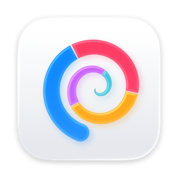
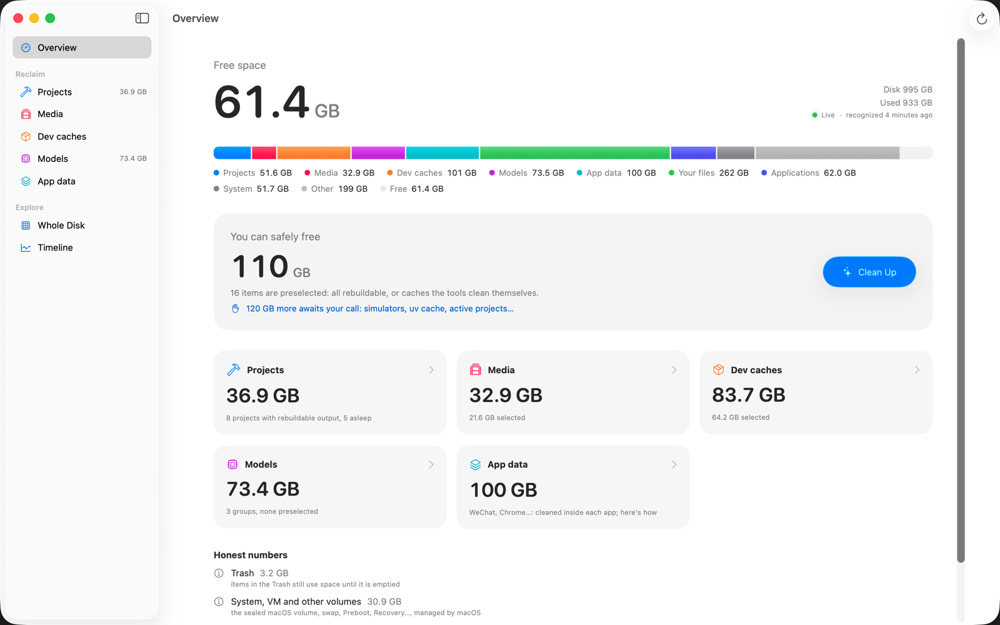
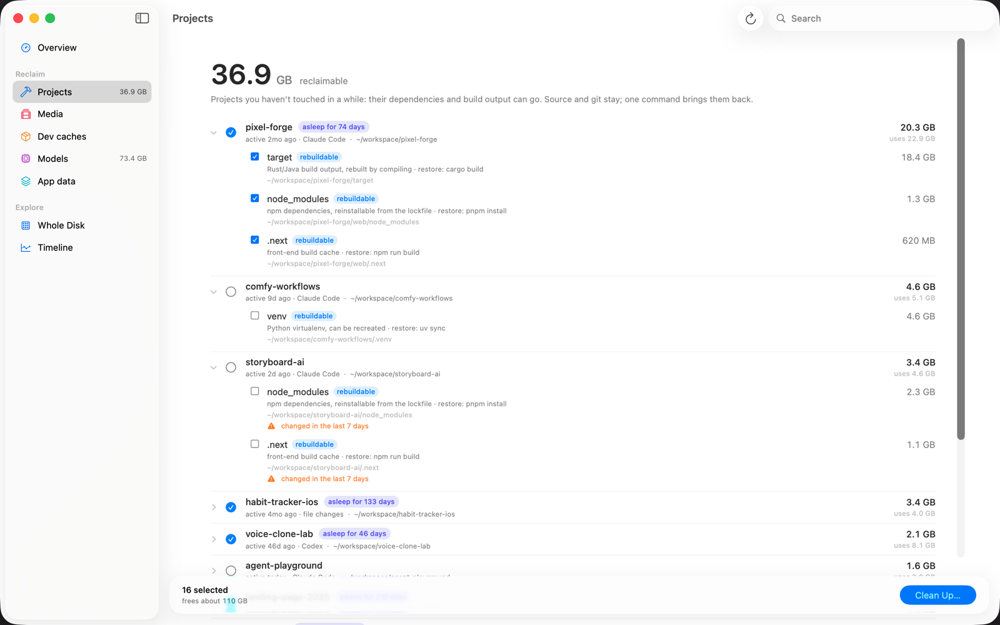
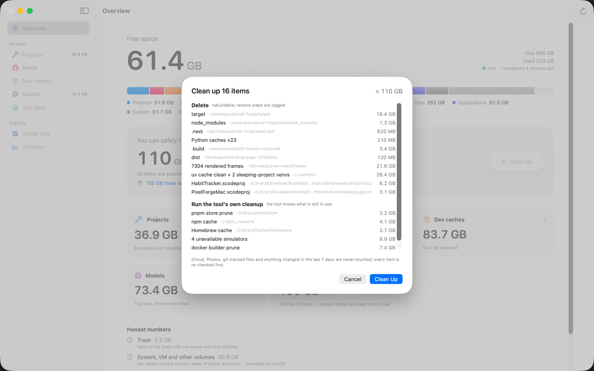
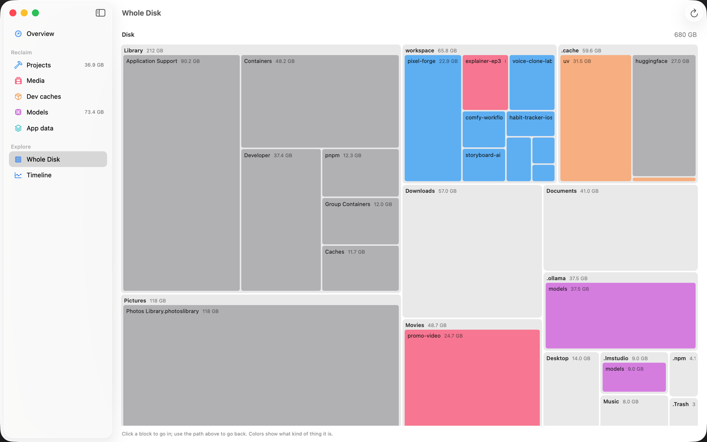
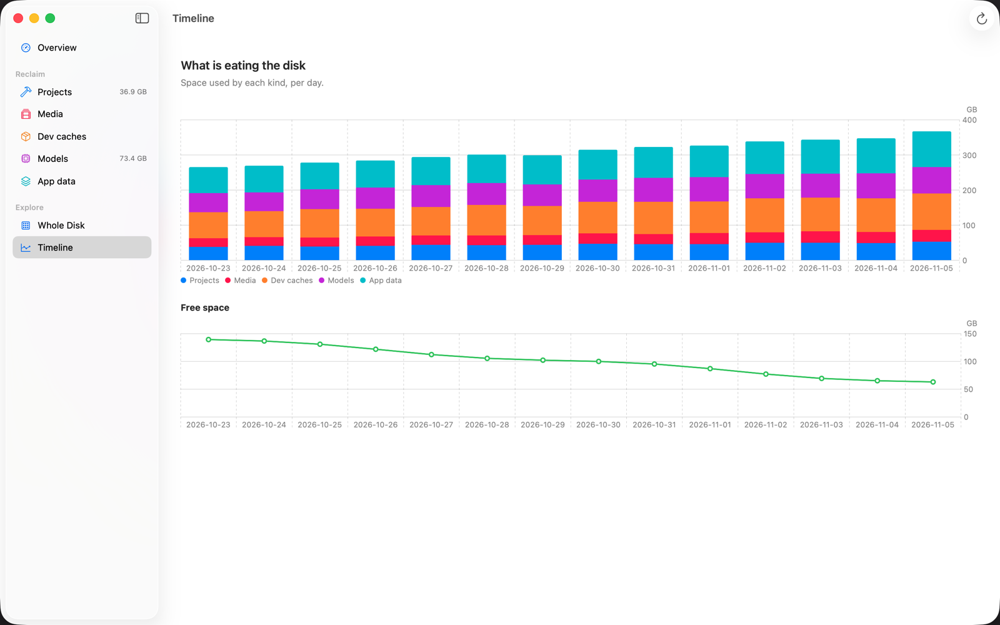

<p align="center">
  
</p>

<h1 align="center">SuckMyDisk</h1>

<p align="center">
  A fast, honest disk-space tool for macOS 26.<br>
  It recognizes projects, render frames, dev caches and local models, and tells you what can safely go.
</p>

<p align="center">
  <b>English</b> · <a href="README.zh-CN.md">简体中文</a>
</p>

<p align="center">
  <a href="https://github.com/kadaliao/suck-my-disk/releases/latest"></a>
  
  <a href="LICENSE"></a>
</p>

---

Disks of people who build things with AI fill up fast: `node_modules` and `.venv`
in every experiment, Rust `target` folders, thousands of rendered video frames,
uv / npm / Homebrew caches, Ollama and Hugging Face models. A folder-size tool
shows you *where* the bytes are. SuckMyDisk tells you *what* they are, whether
they can be rebuilt, how much deleting them really frees, and how to get them
back.



## Highlights

- **Recognizes things, not folders.** Projects and their build output, render
  frames whose final video already exists, developer caches, local models, app
  data and system space each get their own list.
- **Knows when you last worked on something.** Activity comes from Claude Code,
  Codex and shell history, not just file dates. Projects untouched for 30 days
  count as asleep.
- **Honest numbers.** APFS clones and hard links are counted once. If a `.venv`
  is a clone of the uv cache, deleting it alone frees nothing, and SuckMyDisk
  says so instead of promising space you won't get.
- **Safe by default.** Rebuildable things are deleted with a restore command in
  the journal; your own files go to the Trash. iCloud, Photos, `.git`,
  git-tracked files and anything changed in the last 7 days are never touched.
- **Live.** After the first scan the index follows the disk through FSEvents.
  Reopening the app catches up in about a second instead of rescanning.
- **App and command line.** `smd` shares the engine and the index with the app,
  and prints JSON for scripts and coding agents.
- **Local only.** No network requests, no telemetry, no account.
- **Chinese and English**, following the system language.

## What it finds

| Section | Examples | What happens when you clean it |
| --- | --- | --- |
| Projects | `node_modules`, `.venv`, `target`, `.build`, `.next`, `dist` in git-ignored folders | Deleted; source and git stay. A restore command (`pnpm install`, `uv sync`, `cargo build`…) is recorded. |
| Media | Rendered frame folders (`00001.png`…) | Deleted only when the matching final video is found; otherwise moved to the Trash. |
| Dev caches | uv, npm, pnpm, bun, Yarn, pip, Homebrew, Cargo, Xcode DerivedData, iOS Simulators, Docker build cache | The tool's own cleanup command when there is one (`uv cache prune`, `brew cleanup`…), otherwise deleted. |
| Models | Ollama, Hugging Face, ModelScope, LM Studio | `ollama rm`, `hf cache rm`, or Trash. Nothing preselected. |
| App data | WeChat, Chrome, Lark, Notion, iPhone backups… | Never deleted. You get instructions for cleaning inside the app. |

| | |
| --- | --- |
|  |  |
|  |  |

<sub>Screenshots use demo mode (`--demo`), with made-up projects and sizes.</sub>

## Requirements

- macOS 26 (Tahoe) or later, Apple silicon or Intel.
- Full Disk Access is recommended for complete numbers (see below).

## Install

**App.** Download `SuckMyDisk-<version>.zip` from
[Releases](https://github.com/kadaliao/suck-my-disk/releases/latest), unzip it,
and move `SuckMyDisk.app` to `/Applications`. Builds are signed with a
Developer ID and notarized by Apple.

**Command line.** Download `smd-<version>-macos.zip` from the same page and put
`smd` somewhere on your `PATH`:

```sh
unzip smd-*-macos.zip
mkdir -p ~/.local/bin && mv smd ~/.local/bin/
smd help
```

`SHA256SUMS` on the release page lists checksums for both zips.

## Quick start

1. **Open SuckMyDisk.** The first run scans the whole disk, which takes about
   half a minute to a minute. After that it follows the disk live.
2. **Grant Full Disk Access** (System Settings → Privacy & Security → Full Disk
   Access → add SuckMyDisk). Without it, Desktop, Documents, Downloads, iCloud
   Drive, other apps' data and external volumes are left out instead of macOS
   asking about each one. The overview shows a banner with a button that
   opens the right settings page.
3. **Read the overview.** "You can safely free" is the total of the
   preselected items: only things that can be rebuilt or that a tool cleans
   itself.
4. **Click Clean Up**, review the list (grouped into *delete*, *run the tool's
   cleanup* and *move to Trash*), and confirm.
5. **Decide on the rest.** Open Projects, Dev caches or Models in the sidebar,
   tick what you don't need, and use the Clean Up bar at the bottom.

From the terminal:

```sh
smd things            # what uses space and what can go (read-only)
smd reclaim           # dry run of the preselected plan
smd reclaim --yes     # do it
```

The [user guide](docs/user-guide.md) walks through every screen and command.

## How it stays safe

- Every item is re-checked right before it is acted on. Anything that fails a
  check is skipped and reported.
- Never touched: iCloud Drive, cloud-storage folders (Dropbox, OneDrive,
  Google Drive), Photos / Music / Mail / Messages libraries, Keychains, `.ssh`,
  `.gnupg`, anything inside `.git`, git-tracked files, symlinks, and anything
  changed in the last 7 days (the CLI can override only the 7-day rule, with
  `--force`).
- Tools with their own cleanup command (uv, npm, pnpm, bun, Yarn, Homebrew,
  `simctl`, Docker) are run instead of deleting their folders, because the
  tool knows what is still in use. `docker system prune` is never used.
- Every action goes into a journal, with the space actually freed and how to
  restore it (`smd journal`, `smd wake`).

## Documentation

| | |
| --- | --- |
| [User guide](docs/user-guide.md) | Every screen, the full `smd` reference, safety rules, privacy, uninstalling, FAQ |
| [Architecture](docs/architecture.md) | How the scanner, live index, recognizers and executor fit together |
| [Contributing](CONTRIBUTING.md) | Building, testing, conventions, adding a recognizer |
| [Releasing](docs/releasing.md) | Signing, notarizing and publishing a release (maintainers) |
| [Changelog](CHANGELOG.md) | What changed in each version |
| [Security](SECURITY.md) | Reporting a vulnerability or a data-loss bug |

## Build from source

Requires Xcode 26 or later and [XcodeGen](https://github.com/yonaskolb/XcodeGen).

```sh
git clone https://github.com/kadaliao/suck-my-disk.git
cd suck-my-disk

# Command line and tests (no Xcode project needed)
cd Packages/DiskCore
swift build -c release        # .build/release/smd
swift test

# The app
cd ../..
brew install xcodegen
xcodegen generate
open SuckMyDisk.xcodeproj
```

The project is set up to sign with the maintainer's certificates. Without
them, pick your own team in Xcode, or build with an ad-hoc signature:

```sh
xcodebuild -project SuckMyDisk.xcodeproj -scheme SuckMyDisk -configuration Debug \
  -destination 'generic/platform=macOS' -derivedDataPath build/DerivedData \
  CODE_SIGN_IDENTITY=- DEVELOPMENT_TEAM= build
open build/DerivedData/Build/Products/Debug/SuckMyDisk.app
```

See [CONTRIBUTING.md](CONTRIBUTING.md) for the rest of the development setup.

## Contributing

Bug reports, new recognizers and translations are welcome. Please read
[CONTRIBUTING.md](CONTRIBUTING.md) first; for anything that deletes files, the
safety rules there are not negotiable. If SuckMyDisk ever removed something it
shouldn't have, please report it as described in [SECURITY.md](SECURITY.md).

## License

MIT. See [LICENSE](LICENSE).
