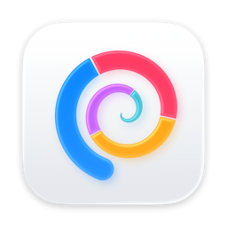
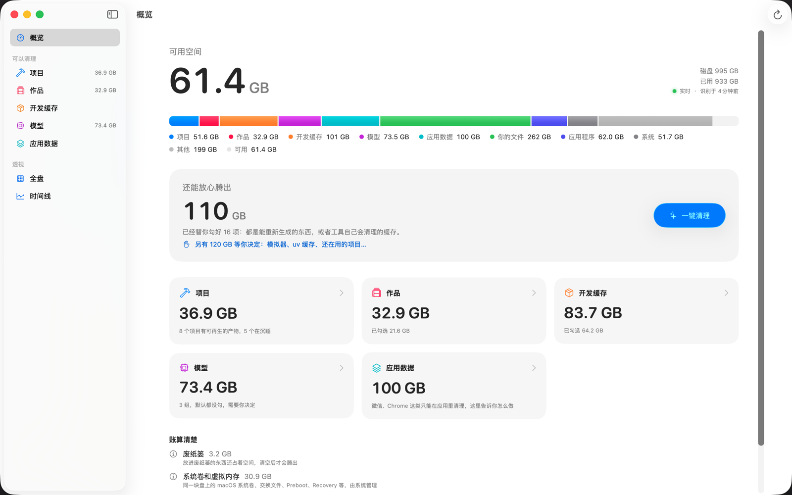
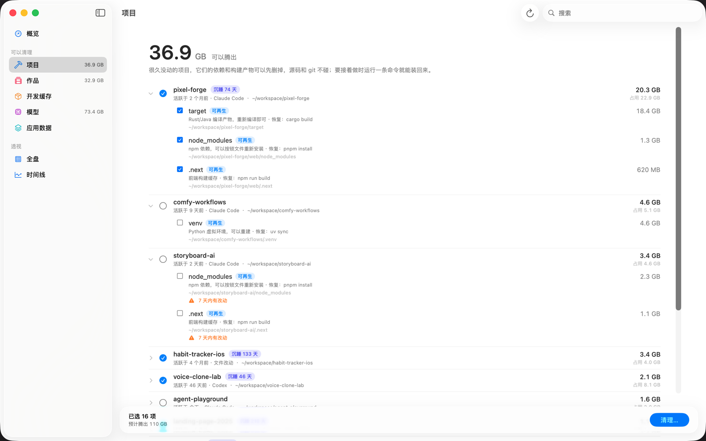
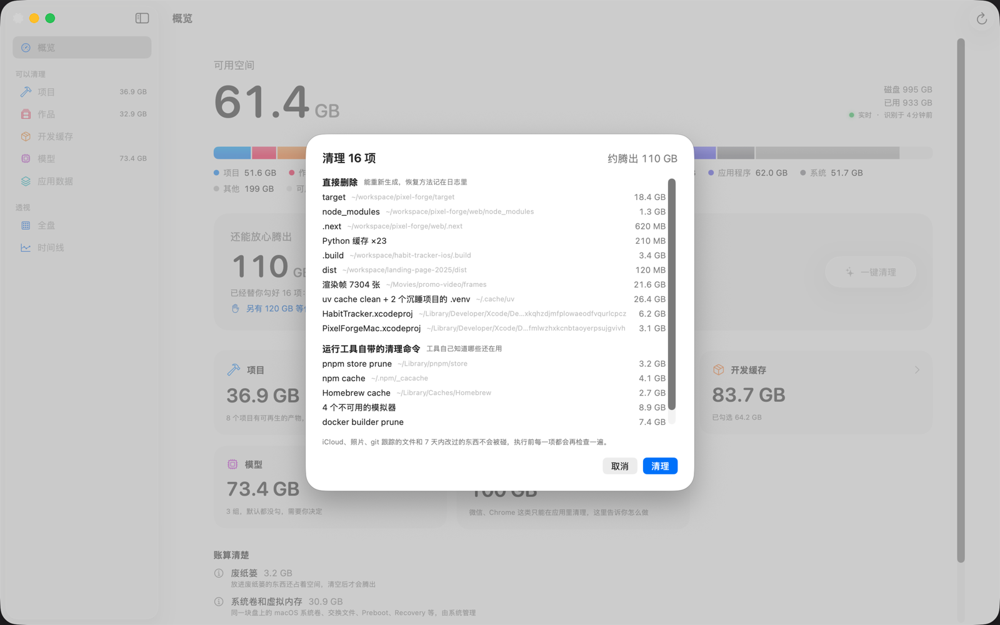
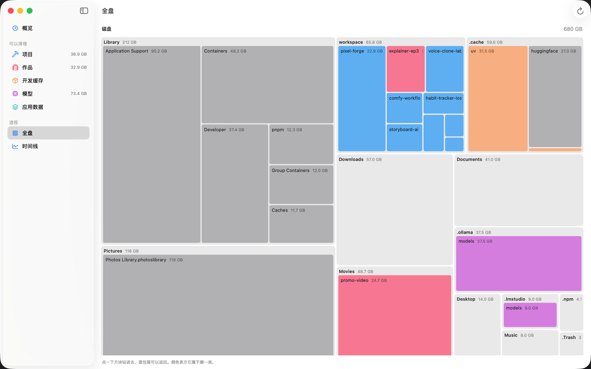
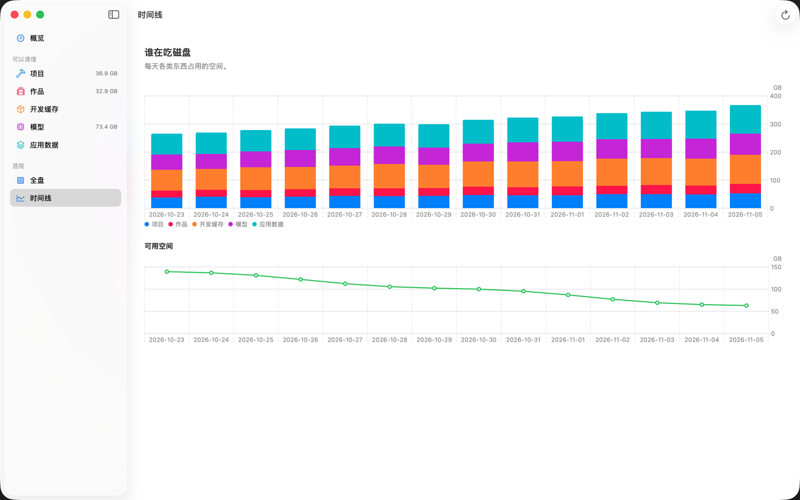

<p align="center">
  
</p>

<h1 align="center">SuckMyDisk</h1>

<p align="center">
  一款又快又实在的 macOS 26 磁盘空间工具。<br>
  它认得出项目、渲染帧、开发缓存和本地模型，告诉你哪些可以放心删。
</p>

<p align="center">
  <a href="README.md">English</a> · <b>简体中文</b>
</p>

<p align="center">
  <a href="https://github.com/kadaliao/suck-my-disk/releases/latest"></a>
  
  <a href="LICENSE"></a>
</p>

---

用 AI 做东西的人，磁盘满得特别快：每个实验都带一份 `node_modules` 和 `.venv`，
Rust 有 `target`，渲染视频留下成千上万张帧，还有 uv、npm、Homebrew 的缓存，
Ollama 和 Hugging Face 的模型。按文件夹统计大小的工具只能告诉你空间在*哪儿*。
SuckMyDisk 告诉你那*是什么*、能不能重新生成、删了实际能腾出多少、以后怎么找回来。



## 亮点

- **认「东西」，不认文件夹。** 项目和它的构建产物、成片已经导出的渲染帧、开发缓存、
  本地模型、应用数据、系统占用，各有各的列表。
- **知道你上次什么时候碰过它。** 活跃度来自 Claude Code、Codex 和 shell 历史，
  不只看文件日期。30 天没动的项目算作沉睡。
- **账算清楚。** APFS 克隆和硬链接只算一次。如果某个 `.venv` 是从 uv 缓存克隆出来的，
  单删它腾不出空间，SuckMyDisk 会直说，不会许给你拿不到的空间。
- **默认就安全。** 能重新生成的东西直接删除，恢复命令记进日志；你自己的文件移到废纸篓。
  iCloud、照片、`.git`、git 跟踪的文件和 7 天内改过的东西一概不碰。
- **实时。** 第一次扫描之后，索引通过 FSEvents 跟着磁盘走。再打开 App 大约一秒就追上，
  不用重新扫描。
- **App 和命令行。** `smd` 和 App 共用同一个引擎、同一份索引，还能输出 JSON，
  给脚本和编程 Agent 用。
- **只在本机。** 不联网，不收集数据，不用注册账号。
- **中文和英文**，跟随系统语言。

## 它能找到什么

| 分类 | 例子 | 清理时会怎样 |
| --- | --- | --- |
| 项目 | `node_modules`、`.venv`、`target`、`.build`、`.next`，以及被 git 忽略的 `dist` | 直接删除，源码和 git 不动。恢复命令（`pnpm install`、`uv sync`、`cargo build`…）会记下来。 |
| 作品 | 渲染出来的帧文件夹（`00001.png`…） | 找到对应的成片才直接删除；找不到就移到废纸篓。 |
| 开发缓存 | uv、npm、pnpm、bun、Yarn、pip、Homebrew、Cargo、Xcode DerivedData、iOS 模拟器、Docker 构建缓存 | 工具有自带的清理命令就用它（`uv cache prune`、`brew cleanup`…），没有才直接删。 |
| 模型 | Ollama、Hugging Face、ModelScope、LM Studio | `ollama rm`、`hf cache rm` 或移到废纸篓。默认一个都不勾。 |
| 应用数据 | 微信、Chrome、飞书、Notion、iPhone 备份… | 从不删除，只告诉你在应用里怎么清。 |

| | |
| --- | --- |
|  |  |
|  |  |

<sub>截图来自演示模式（`--demo`），项目和大小都是虚构的。</sub>

## 系统要求

- macOS 26（Tahoe）或更新版本，Apple 芯片或 Intel 都行。
- 建议开启「完全磁盘访问」，数字才完整（见下文）。

## 安装

**App。** 从 [Releases](https://github.com/kadaliao/suck-my-disk/releases/latest)
下载 `SuckMyDisk-<version>.zip`，解压后把 `SuckMyDisk.app` 拖进「应用程序」
（`/Applications`）。安装包用 Developer ID 签名，并经过 Apple 公证。

**命令行。** 在同一个页面下载 `smd-<version>-macos.zip`，把 `smd` 放到 `PATH`
里的某个目录：

```sh
unzip smd-*-macos.zip
mkdir -p ~/.local/bin && mv smd ~/.local/bin/
smd help
```

发布页上的 `SHA256SUMS` 列出了两个 zip 的校验值。

## 快速上手

1. **打开 SuckMyDisk。** 第一次会扫描整块磁盘，大约半分钟到一分钟。之后它实时跟着磁盘更新。
2. **开启「完全磁盘访问」**（系统设置 → 隐私与安全性 → 完全磁盘访问权限 → 加入 SuckMyDisk）。
   不开的话，桌面、文稿、下载、iCloud 云盘、其他 App 的数据和外接磁盘都会先跳过，
   而不是让 macOS 一个个弹窗问你。概览页会显示一条提示，点按钮直接打开对应的设置页。
3. **看概览。**「还能放心腾出」是预选项目的合计：只包括能重新生成的东西，
   或者工具自己会清理的缓存。
4. **点「一键清理」**，核对清单（分成「直接删除」「运行工具自带的清理命令」
   「移到废纸篓」三组），确认。
5. **剩下的你来决定。** 在侧边栏打开「项目」「开发缓存」或「模型」，
   勾上不需要的，再点底部栏的「清理…」。

在终端里：

```sh
smd things            # 看看空间被谁占了、能腾出多少（只读）
smd reclaim           # 预演预选的清理计划
smd reclaim --yes     # 真正执行
```

[使用指南](docs/user-guide.zh-CN.md)逐一介绍了每个界面和每条命令。

## 怎样保证安全

- 每一项在动手前都会再检查一遍。没通过检查的会跳过，并说明原因。
- 从不碰：iCloud 云盘、云存储文件夹（Dropbox、OneDrive、Google Drive）、
  照片 / 音乐 / 邮件 / 信息的资料库、钥匙串、`.ssh`、`.gnupg`、`.git` 里的任何东西、
  git 跟踪的文件、符号链接，以及 7 天内改过的东西（命令行可以用 `--force`
  跳过的只有 7 天这一条）。
- 有自带清理命令的工具（uv、npm、pnpm、bun、Yarn、Homebrew、`simctl`、Docker），
  就运行它的命令，而不是删它的文件夹，因为工具自己知道哪些还在用。
  从不运行 `docker system prune`。
- 每个操作都记进日志，包括实际腾出了多少空间、怎么恢复（`smd journal`、`smd wake`）。

## 文档

| | |
| --- | --- |
| [使用指南](docs/user-guide.zh-CN.md) | 每个界面、完整的 `smd` 命令说明、安全规则、隐私、卸载、常见问题 |
| [架构](docs/architecture.zh-CN.md) | 扫描器、实时索引、识别器和执行器是怎么配合的 |
| [贡献指南](CONTRIBUTING.zh-CN.md) | 构建、测试、约定、添加识别器 |
| [发布流程](docs/releasing.zh-CN.md) | 签名、公证、发布新版本（维护者用） |
| [更新日志](CHANGELOG.zh-CN.md) | 每个版本改了什么 |
| [安全](SECURITY.md) | 报告漏洞或误删数据的问题 |

## 从源码构建

需要 Xcode 26 或更新版本，以及 [XcodeGen](https://github.com/yonaskolb/XcodeGen)。

```sh
git clone https://github.com/kadaliao/suck-my-disk.git
cd suck-my-disk

# 命令行和测试（不需要 Xcode 工程）
cd Packages/DiskCore
swift build -c release        # .build/release/smd
swift test

# App
cd ../..
brew install xcodegen
xcodegen generate
open SuckMyDisk.xcodeproj
```

工程默认用维护者的证书签名。没有这些证书的话，在 Xcode 里选你自己的 Team，
或者用 ad-hoc 签名构建：

```sh
xcodebuild -project SuckMyDisk.xcodeproj -scheme SuckMyDisk -configuration Debug \
  -destination 'generic/platform=macOS' -derivedDataPath build/DerivedData \
  CODE_SIGN_IDENTITY=- DEVELOPMENT_TEAM= build
open build/DerivedData/Build/Products/Debug/SuckMyDisk.app
```

其余开发环境的配置见 [CONTRIBUTING.zh-CN.md](CONTRIBUTING.zh-CN.md)。

## 参与贡献

欢迎报告问题、补充识别器、改进翻译。请先读
[CONTRIBUTING.zh-CN.md](CONTRIBUTING.zh-CN.md)；凡是涉及删除文件的改动，
里面的安全规则没有商量余地。如果 SuckMyDisk 删了不该删的东西，
请按 [SECURITY.md](SECURITY.md) 里的方式报告。

## 许可证

MIT，见 [LICENSE](LICENSE)。
