# SuckMyDisk user guide

**English** · [简体中文](user-guide.zh-CN.md)

This guide covers the app, the `smd` command line, the safety rules, and what
SuckMyDisk reads and stores. For installation, see the [README](../README.md#install).

- [First run](#first-run)
- [Full Disk Access](#full-disk-access)
- [The window](#the-window)
- [Overview](#overview)
- [Reclaim lists](#reclaim-lists)
  - [Projects](#projects) · [Media](#media) · [Dev caches](#dev-caches) · [Models](#models) · [Large files](#large-files) · [Apps](#apps) · [App data](#app-data)
  - [Browsers](#browsers)
- [Cleaning up](#cleaning-up)
- [Whole Disk](#whole-disk)
- [Timeline](#timeline)
- [Menu bar](#menu-bar)
- [Live updates and rescanning](#live-updates-and-rescanning)
- [Updating SuckMyDisk](#updating-suckmydisk)
- [Command line (`smd`)](#command-line-smd)
- [Safety rules](#safety-rules)
- [Data and privacy](#data-and-privacy)
- [Uninstalling](#uninstalling)
- [FAQ and troubleshooting](#faq-and-troubleshooting)
- [Known limitations](#known-limitations)

## First run

The first time you open SuckMyDisk it scans the whole startup disk. On a disk
with about five million files this takes half a minute to a minute; a pill at
the bottom of the window shows the file count and bytes so far.

When the scan finishes, SuckMyDisk recognizes projects, frames, caches and
models, and the overview appears. From then on the index is saved and kept
current through FSEvents, so later launches only replay what changed while the
app was closed (usually under a second).

The app follows the system language: Chinese if Chinese is your first
preferred language, English otherwise. To pick one yourself, open **Settings**
(⌘,) → **Language** and choose 简体中文 or English; the change shows after the
app reopens (**Relaunch Now** does it in a second or two, and scan results are
kept). **Appearance** in the same place picks Light or Dark instead of
following the system, and changes right away.

## Full Disk Access

macOS asks for permission before an app reads some folders: Desktop,
Documents, Downloads, iCloud Drive, other apps' containers and external
volumes. Instead of raising a dialog for each one, SuckMyDisk leaves those
folders out until it has Full Disk Access, and the overview shows a banner
saying what is missing. [External disks](#external-disks) are scanned as soon
as they are plugged in once SuckMyDisk has Full Disk Access; without it, a
disk's page waits for you to click **Scan**, and macOS asks once.

To grant it:

1. Click **Open System Settings** in the banner, or go to System Settings →
   Privacy & Security → Full Disk Access.
2. Turn on SuckMyDisk (use **+** to add it from `/Applications` if it is not
   listed).
3. Quit and reopen SuckMyDisk.

For `smd`, macOS checks the terminal app that runs it, so grant Full Disk
Access to your terminal (Terminal, iTerm2, Ghostty, …) instead.

SuckMyDisk only reads file metadata to measure the disk. See
[Data and privacy](#data-and-privacy) for exactly what it opens.

## The window

The sidebar has three groups, and a fourth when an external disk is connected:

| Group | Sections |
| --- | --- |
| — | **Overview** |
| Reclaim | **Projects**, **Media**, **Dev caches**, **Models**, **Apps**, **App data**; each shows how much it can free (Apps: how much the apps and their data take up) |
| Explore | **Whole Disk** (treemap), **Timeline** (growth per day) |
| External Disks | One row per connected disk; see [External disks](#external-disks) |

The toolbar's ↻ button (or **File → Rescan**, ⌘R) rescans the disk on screen:
the startup disk, or the external disk whose page is open. For the startup
disk you rarely need it; see [Live updates](#live-updates-and-rescanning).

## Overview

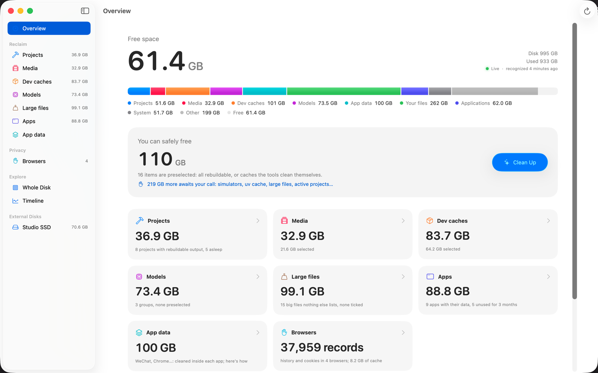

- **Free space**, with the disk size and used space on the right. Below them,
  a badge shows whether the index is **Live**, catching up, or not following
  the disk, and when recognition last ran.
- **Capacity bar.** Used space split into Projects, Media, Dev caches, Models,
  App data, Your files, Applications, System and Other, plus Free.
- **You can safely free.** The total of the preselected items: only things
  that can be rebuilt, or caches that their tool cleans itself. **Clean Up**
  opens the confirmation sheet for exactly those items.
- **"… more awaits your call."** When more than 1 GB is reclaimable but not
  preselected (simulators, the whole uv cache, projects you are still working
  on), a link takes you to it. Apps are not counted here.
- **Category cards.** One per reclaim list with its total (for Apps, the space
  the apps and their data take up); click to open it.
- **Honest numbers.** Space SuckMyDisk can explain but not reclaim for you:
  - **Trash**: still uses space until emptied.
  - **Local snapshots**: created by macOS updates and Time Machine. Their
    space can't be measured by scanning, and deleted files stay allocated
    while a snapshot holds them.
  - **Not visible to the scan**: the data volume's used space minus what the
    scan found (snapshot space, unreadable folders), and how much macOS marks
    as purgeable.
  - **System, VM and other volumes**: the sealed system volume, swap,
    Preboot, Recovery.

## Reclaim lists

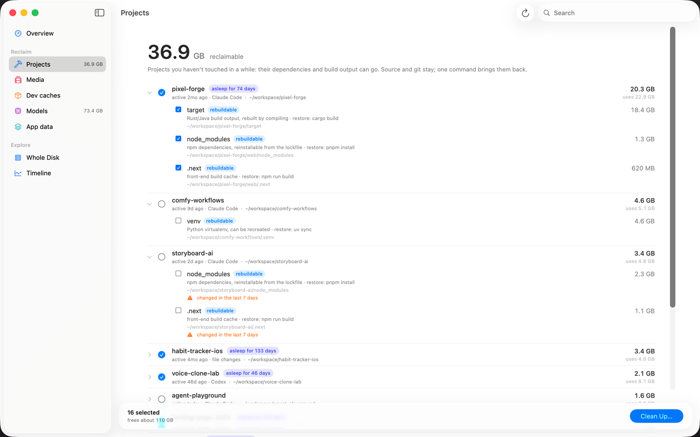

Projects, Media, Dev caches, Models, Apps and App data share one layout:

- At the top: the total that can be freed, and a sentence on what this list
  is about. The search field in the toolbar filters the list.
- **Groups** (a project, a cache, a model store). Click a row to expand it.
  The circle selects or clears every item in the group (a dash means some are
  selected). Under the title: when it was last active and according to what
  (Claude Code, Codex, shell, file changes, Finder), and its path. On the
  right: what it can free and, in grey, what it occupies in total.
- **Items** inside a group, each with a checkbox, a badge, the reason it is
  listed, and its restore command:

  | Badge | Meaning | Action |
  | --- | --- | --- |
  | rebuildable | Can be rebuilt or downloaded again | Deleted directly, or the tool's cleanup command runs |
  | to Trash | Your own files | Moved to the Trash |
  | guide | Only the app that owns it can clean it | Nothing; instructions are shown |

- A **+** after a size (for example `565 MB+`) means part of the data is
  shared with other files through APFS clones or hard links, so the figure is
  a lower bound. Large items get an exact number after recognition.
- **⚠ warnings** explain why an item is not preselected: changed in the last
  7 days, no lockfile, shared with another folder, and so on.
- Right-click a group or an item for **Show in Finder**.
- When anything is selected, a bar at the bottom shows how many items and how
  much they free, with a **Clean Up…** button.

Your selection survives background refreshes.

### Projects

A project is a git repository, or a folder with a package manifest
(`package.json`, `pyproject.toml`, `Cargo.toml`, `go.mod`, `Package.swift`,
an Xcode project, `pom.xml`, Gradle, `setup.py`, `Gemfile`, `pubspec.yaml`,
`CMakeLists.txt`). Hidden folders in your home folder and `~/Library` are not
searched for projects.

Inside each project SuckMyDisk looks for build output and dependencies:

| Artifact | Recognized when | Restore command |
| --- | --- | --- |
| `node_modules` | next to a `package.json` | `pnpm install`, `bun install`, `yarn install` or `npm ci`, from the lockfile; `npm install` without one |
| virtualenv (`.venv`, any folder with `pyvenv.cfg`) | inside the project | `uv sync`, `poetry install`, or `python3 -m venv` (+ `pip install -r requirements.txt`) |
| `target` | Cargo or Maven project, or a `CACHEDIR.TAG` | `cargo build` / `mvn package` |
| `.next`, `.nuxt`, `.turbo`, `.svelte-kit`, `.parcel-cache`, `.angular` | next to a `package.json` | `npm run build` |
| `.build` | next to `Package.swift` | `swift build` |
| `.gradle` | Gradle project | `./gradlew build` |
| `.dart_tool` | next to `pubspec.yaml` | `flutter pub get` |
| `build`, `dist`, `out` | git ignores the folder, git tracks nothing in it, and it holds no video or audio | `npm run build` for JS projects |
| `__pycache__`, `.mypy_cache`, `.pytest_cache`, `.ruff_cache` | anywhere in the project; listed together as "Python caches" | rebuilt automatically |

A project is **asleep** when nothing shows activity for 30 days. Activity
comes from, newest first: Claude Code and Codex sessions in that folder,
`cd` lines in your fish or zsh history, the Spotlight last-used date, and file
modification times in the project.

An artifact is **preselected** only if the project is asleep, the evidence is
strong (for example a lockfile exists, so a reinstall gives the same
versions), and nothing in it changed in the last 7 days. Active projects are
listed too, unticked, so you can still free their space by hand.

Source code and `.git` are never touched. `smd wake` shows the commands to
bring a project's dependencies back.

### Media

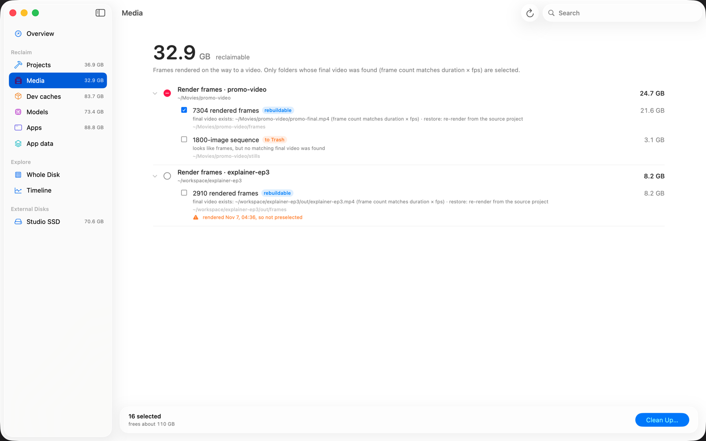

Folders of rendered frames: at least 300 images (`png`, `jpg`, `exr`, `tif`,
`dpx`, …) and 50 MB. Frames are grouped by the project they belong to.

- If a video nearby has the same number of frames (give or take a few), the
  frames are **rebuildable**: the final video exists and the frames can be
  rendered again from the source project. They are preselected unless they
  were rendered in the last 7 days. A video doesn't count if it is inside
  another project (a folder with its own git repo or manifest) or next to
  another frame folder: episode 19's video belongs to episode 19's frames,
  even when episode 20's own video is gone.
- If no matching video is found, the folder is listed as an **image
  sequence**, handled as your files (to Trash), and not preselected. Camera
  bursts and photo folders end up here.

Only the frame folder itself is offered, never its parent: render folders
often hold paid text-to-speech audio and stills next to the frames.

### Dev caches

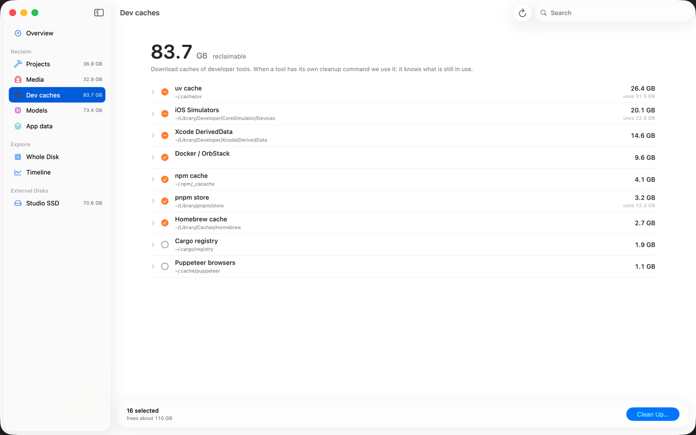

| Cache | Action | Preselected |
| --- | --- | --- |
| uv | `uv cache prune` (old-format buckets, unreferenced entries) | yes |
| | `uv cache clean` (everything) | no |
| | `uv cache clean` + the `.venv`s of sleeping projects | when it frees much more than either alone |
| npm | `npm cache clean --force` | yes |
| npx | delete the packages npx installed in `~/.npm/_npx`, one row per package; skips any a running program uses (MCP servers often run this way) and any installed in the last 7 days | yes |
| pnpm store | `pnpm store prune` (packages no project uses) | yes |
| bun | `bun pm cache rm` | yes |
| Yarn | `yarn cache clean` | yes |
| pip | delete `~/Library/Caches/pip` | yes |
| Homebrew | `brew cleanup --prune=all -s` | yes |
| Cargo registry | delete `~/.cargo/registry` | no |
| Puppeteer browsers | delete `~/.cache/puppeteer` | no |
| Xcode DerivedData | delete per project | when the project is gone or unused for 30 days |
| iOS Simulators | `xcrun simctl delete unavailable` | yes |
| | delete simulators not booted for 6 months | no (their apps and data are lost) |
| Docker / OrbStack | `docker builder prune -f`, `docker image prune -f` (dangling images) | yes |

When the tool is not installed, its folder is deleted instead. Caches under
50 MB are not listed.

**Why uv has three options.** uv installs packages into each `.venv` as APFS
clones of its cache. Clones share data blocks, so clearing the cache alone
frees only what no `.venv` uses, and deleting a `.venv` alone frees only what
the cache doesn't hold. SuckMyDisk measures both and offers the combination
(cache + the environments of sleeping projects) when that is where the space
really is. The warnings say how much stays shared.

`docker system prune` is never used, because it also deletes stopped
containers and images you built locally. After Docker cleanup, the virtual
machine's disk image on the Mac may shrink only later.

### Models

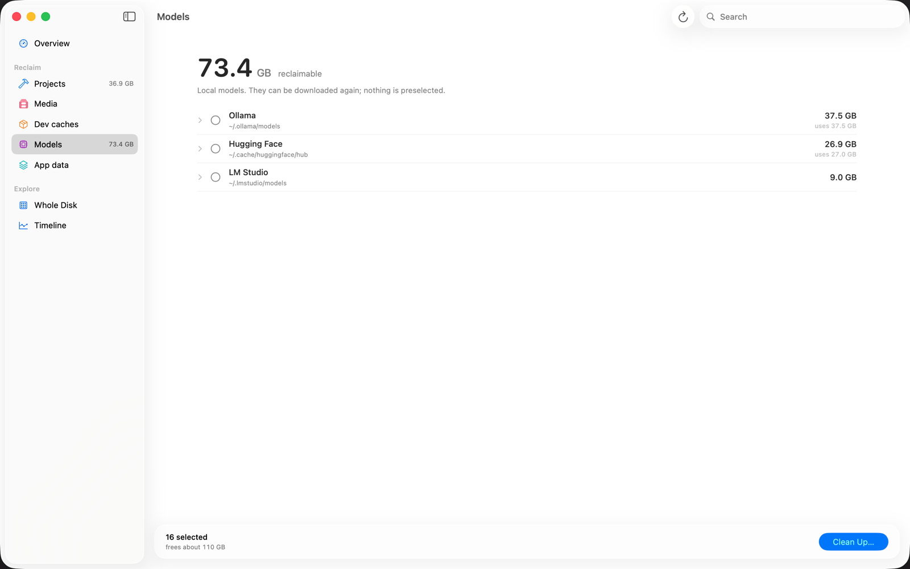

| Source | Action | Restore |
| --- | --- | --- |
| Ollama | `ollama rm <model>` (shared layers counted once) | `ollama pull <model>` |
| Hugging Face | `hf cache rm <repo>` if the `hf` CLI is installed, otherwise delete | downloaded again when used |
| ModelScope | delete | downloaded again when used |
| LM Studio | move to Trash | download again in LM Studio |

Nothing here is preselected.

### Large files

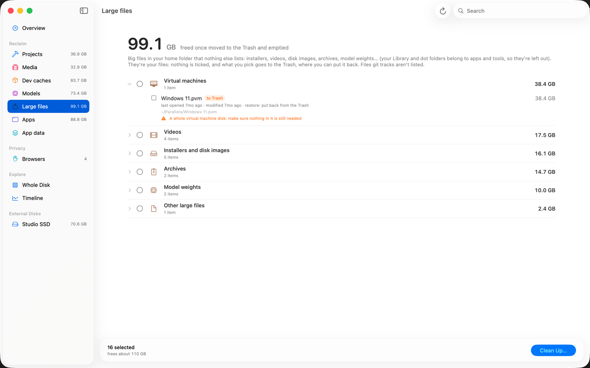

Big files in your home folder that no other list explains, grouped by kind,
largest first:

| Group | Examples |
| --- | --- |
| Installers and disk images | `.dmg`, `.pkg`, `.iso`, `.xip`, `.ipsw`, sparse bundles (20 MB and up) |
| Virtual machines | `.vmdk`, `.qcow2`, `.vdi`, Parallels, VMware and UTM bundles |
| Videos, Audio | `.mp4`, `.mov`, `.mkv`…, `.wav`, `.flac`… |
| Archives | `.zip`, `.tar.gz`, `.7z`, `.rar`… |
| Model weights | `.safetensors`, `.gguf`, `.ckpt`, `.onnx`… A model split into shards (a folder with `model_index.json`, or `config.json` next to its weights) is listed as one folder. |
| Apps outside Applications | an `.app` in Downloads or a build folder |
| Other large files | anything else of 100 MB or more; their type isn't recognized, so check they aren't another program's data |

Files are listed from 100 MB (installers from 20 MB), at most 50 per group;
the group says how many more there are. Under each file: whether the app an
installer is for is already installed, when it was last opened and where it
was downloaded from (both from Spotlight), and when it last changed.

Left out: your Library and dot folders (they belong to apps and tools),
anything another list already shows (a project's `node_modules`, a frames
folder), files git tracks, folded dependency folders, Photos and other media
libraries, and the chunks of an encrypted Cryptomator vault.

They are your files: nothing is preselected, and what you pick goes to the
Trash, where you can put it back. Like your other files they wait out the
7-day rule even when ticked. A file in iCloud Drive (Desktop and Documents
synced with iCloud) carries a warning: moving it to the Trash removes it from
all your devices.

### Apps

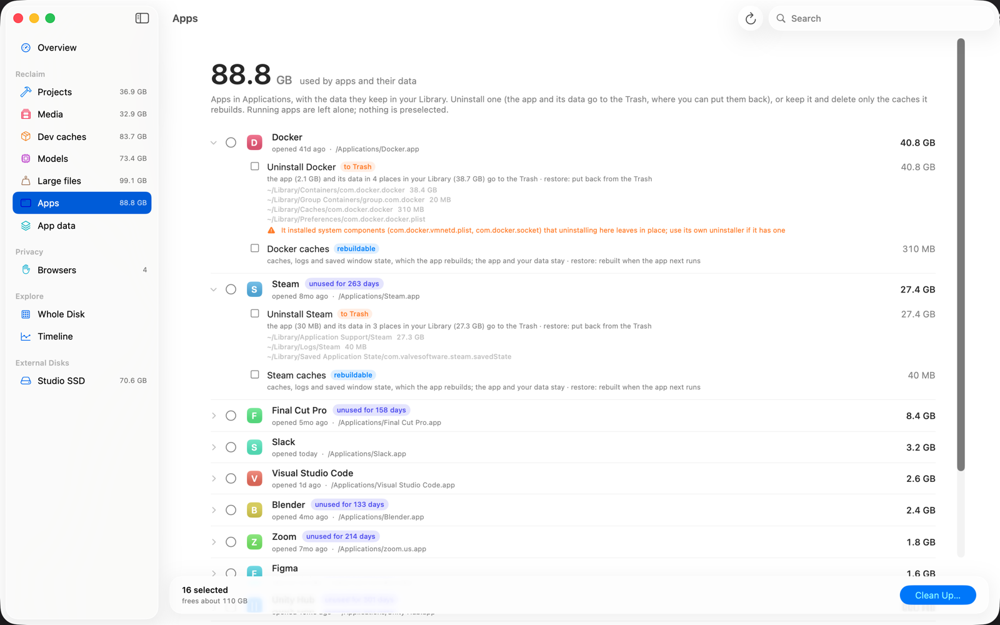

Every app in `/Applications` and `~/Applications` (and one folder down, such
as a vendor's folder), with the data it keeps in your Library, largest first.
`Utilities`, apps macOS protects (Safari), symlinks and SuckMyDisk itself are
left out. Under each app's name: when it was last opened (from Finder's record
and Spotlight) and where it is. Apps not opened for 90 days carry an
"unused for N days" tag.

Each app has up to two items. Nothing is preselected.

| Item | What happens | Badge |
| --- | --- | --- |
| **Uninstall** | The app and every data folder found for it go to the Trash, the app first. The folders are listed under the item with their sizes. | to Trash |
| **Caches** | Its caches, logs and saved window state are deleted. The app, its settings and your data stay; it rebuilds the rest when it next runs. Shown when they add up to 1 MB or more. | rebuildable |

Ticking Uninstall includes Caches. The space taken by things moved to the
Trash comes back when you empty the Trash.

**Where an app's data is found** (all in `~/Library`):

| Folder | Matched by | Uninstall | Caches |
| --- | --- | --- | --- |
| `Caches`, `Logs` | bundle id, or the app's exact name | ✓ | ✓ |
| `Saved Application State` | bundle id | ✓ | ✓ |
| `Application Support` | bundle id, or the app's exact name | ✓ | its `Cache`, `Code Cache`, `GPUCache` and similar folders (Electron and Chromium apps) |
| `Containers` | bundle id | ✓ | `Data/Library/Caches` inside it |
| `Group Containers` | `<team id>.<bundle id>` or `group.<bundle id>` | ✓ | |
| `HTTPStorages`, `WebKit`, `Cookies` | bundle id | ✓ | |
| `Preferences`, `LaunchAgents` | bundle id (`.plist`) | ✓ | |

"Bundle id" includes names that extend it, such as `com.tinyspeck.slackmacgap.ShipIt`
or an extension's `….FinderSync`; when two apps' ids both match, the longer id
wins. A folder named after the app counts only if the name is specific to one
app (not `Code`, `Google` or `Python`, and not shared by two apps). A vendor's
own folder (`com.microsoft`, say) is never taken for one of its apps.
`Containers` and `Group Containers` are only seen with
[Full Disk Access](#full-disk-access).

**Warnings** on Uninstall say when:

- Finder will ask for an administrator password: apps from the App Store or an
  installer belong to the system, so SuckMyDisk asks Finder to move them, just
  as if you dragged them to the Trash. The first time, macOS also asks whether
  SuckMyDisk may control Finder. While Finder waits for your answer, the Clean
  Up page says so under the item; with no answer in two minutes the item
  fails and the app stays where it is. With
  [the helper](#uninstalling-without-a-password) on there is no dialog, and
  this warning is not shown.
- the app installed components for every user (launch daemons, privileged
  helpers in `/Library`). Uninstalling here leaves them; use the app's own
  uninstaller if it has one.
- Homebrew installed it: run `brew uninstall --cask <name>` afterwards so
  Homebrew forgets it and removes its command-line links.
- Setapp manages it: uninstall it in Setapp, or Setapp may put it back.

**Safety.** Both items are skipped while anything runs from the app, including
its helpers and a copy macOS runs from a hidden folder; quit it first. Picked
by hand, they don't wait out the 7-day rule (opening an app changes its
folders), since "not running" is the check that matters for an app and
everything goes to the Trash or is rebuilt. If a folder disappeared since the
scan (an app tidying its own caches), the rest still goes; if the app itself is
gone, the item is skipped.

#### Uninstalling without a password

Apps from the App Store or an installer belong to the system, so every time
one goes to the Trash, Finder asks for an administrator password. To be asked
only once, open **Settings** (⌘,) and turn on **Uninstall system apps without
a password**. macOS opens System Settings → General → Login Items &
Extensions; allow SuckMyDisk there (this is the one time it asks for your
password or Touch ID). Back in SuckMyDisk the switch stays on, and from then
on such an app goes to the Trash like any other.

What you allowed is a small helper inside SuckMyDisk that macOS runs with
administrator rights. It is kept as small as it can be:

- It does one thing: move an app that is directly in the Applications folder
  (or one folder down) to your own Trash. Not Utilities, not anything macOS
  protects, not an app that is running, and not SuckMyDisk.
- It only answers this copy of SuckMyDisk, checked by its signature, and only
  for an administrator account, as Finder would.
- It runs only while SuckMyDisk is uninstalling something and quits half a
  minute later.
- If it can't move an app, SuckMyDisk asks Finder as before, and the journal
  says why.

Turn it off with the same switch, or in System Settings. Only builds
downloaded from GitHub have the helper, and `smd` doesn't use it.

### App data

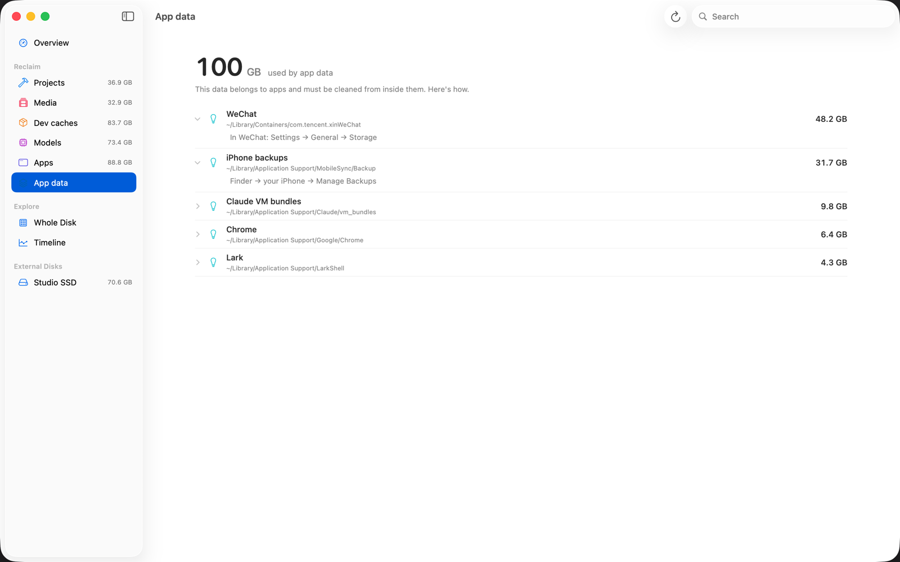

Large data that belongs to an app (1 GB or more): WeChat, Chrome, Lark,
Notion, Claude's VM bundles, OrbStack, iPhone backups. Deleting these folders
directly can break the app, so SuckMyDisk only tells you where to clean them
from inside the app, for example *WeChat → Settings → General → Storage*.
To remove an app together with all its data, use [Apps](#apps) instead.

### Browsers

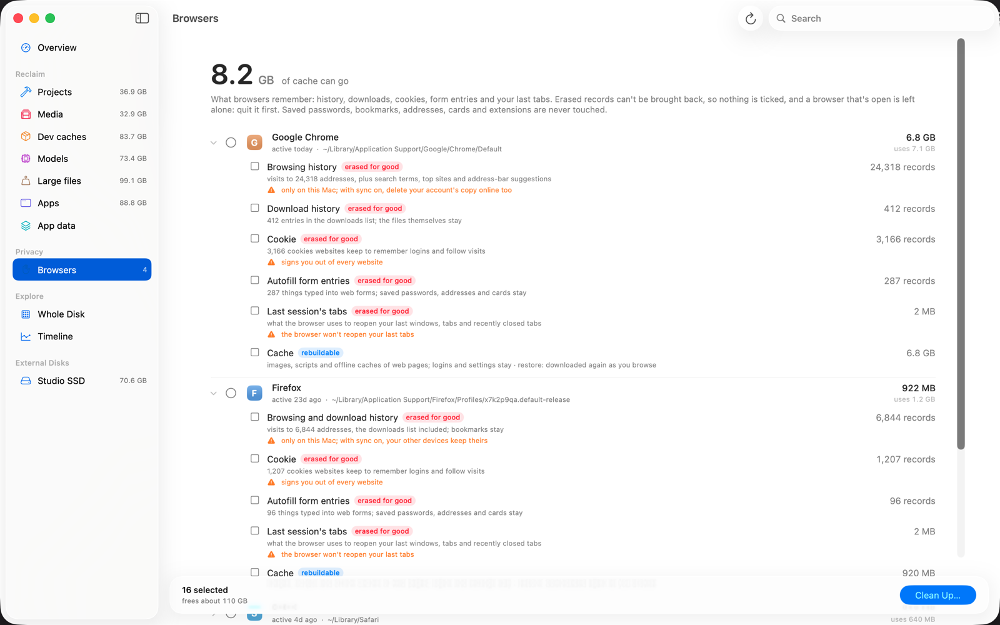

Under **Privacy** in the sidebar: what each browser remembers about where
you've been. One group per browser profile, with its app icon. A browser that
was removed but left its data behind is listed too, tagged as such.

| Item | What happens | Badge |
| --- | --- | --- |
| **Browsing history** | Visits, typed addresses, search terms, top sites, address-bar shortcuts and typing predictions are erased from the browser's databases. Downloads stay unless picked too. | erased for good |
| **Download history** | The downloads list is erased. The downloaded files stay. | erased for good |
| **Cookies** | All cookies are erased: you are signed out of every website. | erased for good |
| **Autofill form entries** | What you typed into web forms. Saved passwords, addresses and cards stay. | erased for good |
| **Last session's tabs** | What the browser uses to reopen your last windows and recently closed tabs. | erased for good |
| **Cache** | Images, scripts and offline caches, rebuilt as you browse. Logins and settings stay. | rebuildable |

Each erase item shows how many records it holds instead of a size: erasing
records frees next to nothing.

Supported: Chrome (and Beta, Canary), Chromium, Edge, Brave, Arc, Dia,
Vivaldi, Opera, Comet, Yandex, and Firefox, Zen, LibreWolf, Waterfox and
Floorp. Firefox's history includes its downloads list, and bookmarked pages
stay in it.

**Safari** is guidance only, apart from its cache: Safari syncs history
through iCloud, and only its own *History → Clear History…* removes it on your
other devices as well. Cookies and website data: *Settings → Privacy → Manage
Website Data… → Remove All*. Safari's history count needs Full Disk Access.

**Never touched:** saved passwords, bookmarks, addresses and cards, search
engines, extensions and their settings, and Local Storage and IndexedDB
(extensions keep their settings there too).

**Safety.** Nothing here is preselected, ever. While the browser is open its
items are skipped: quit it first (some browsers keep running in the
background after their last window closes). A database still held open is
left as it was. Records are erased in one transaction, so a database is
either fully erased or unchanged, and then compacted so they don't linger in
free space. Only this Mac's copy is erased: with the browser's sync on,
delete your account's copy online as well. Picked by hand, these items don't
wait out the 7-day rule (a browser's data always changed this week).

## Cleaning up

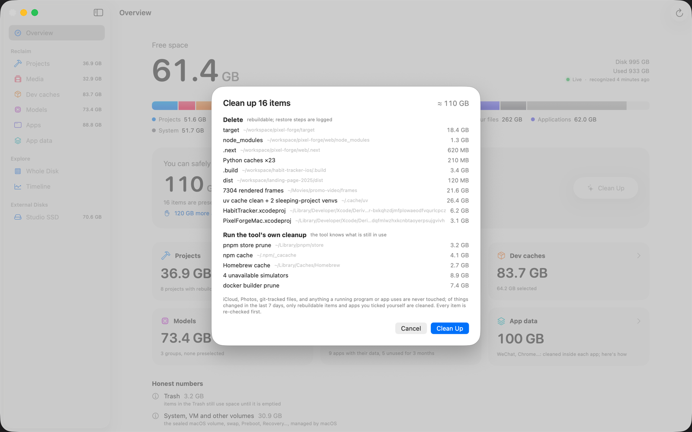

1. Click **Clean Up** on the overview (the preselected items) or **Clean Up…**
   in a list's bottom bar (your selection).
2. The sheet shows the total and every item, grouped by what will happen:
   - **Erase browser records**: gone for good; skipped while the browser is open.
   - **Uninstall apps**: each app and its data go to the Trash.
   - **Delete**: rebuildable; the restore steps are logged.
   - **Run the tool's own cleanup**: the tool knows what is still in use.
   - **Move to Trash**: your files, recoverable from the Trash.
3. Click **Clean Up** to confirm, or **Cancel**.

Once you confirm, Clean Up takes the whole window:

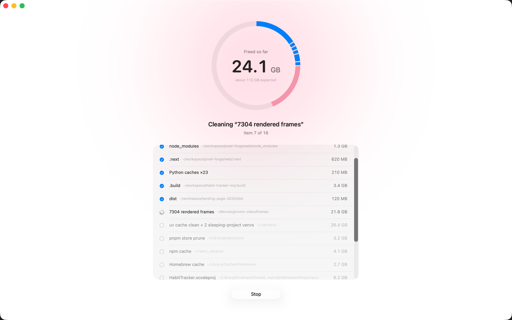

Items run one at a time. The ring fills in item by item, in each kind's color,
and the number in the middle is the space freed so far, measured from the
volume's free space, not estimated. The list below shows whether each item is
waiting, running, done, skipped or failed. Right before each one, every
[safety rule](#safety-rules) is checked again; anything that fails is skipped
with the reason. **Stop** works at any moment: the item that is running is
interrupted before its next step (a cleanup command or a wait for Finder's
password dialog is ended), the rest is left alone, and what already went stays
gone. When the run ends, the same page shows the result: how much was
freed, what didn't go and why, and how long it took. Click **Done** to go back.

Moved-to-Trash items still use space until you empty the Trash; the result
says how much.

## Whole Disk

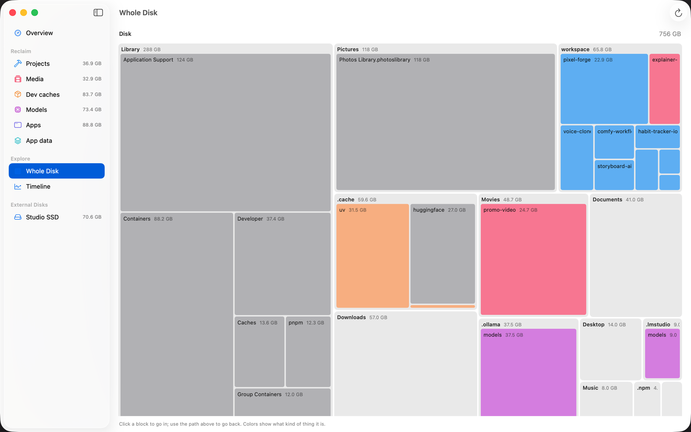

A treemap of the entire disk, colored by category. Click a block to go into
it; click a name in the path above the map to go back. After a cleanup the
map asks for a rescan before it is shown again.

## External disks

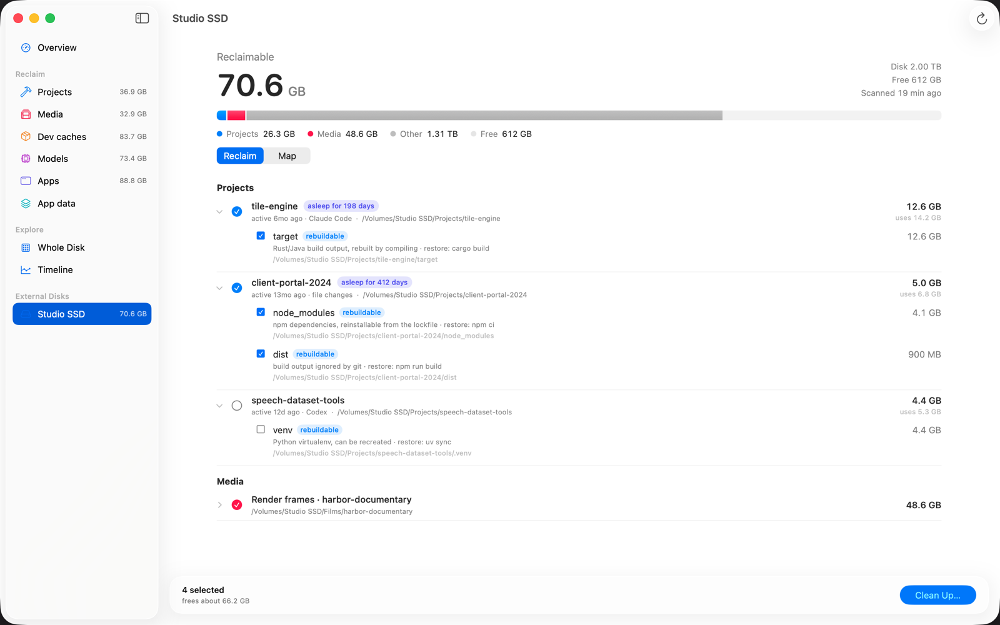

Every connected disk (USB or Thunderbolt drive, SD card, writable disk image)
gets a row under **External Disks** in the sidebar. Its page shows how much can
be freed on it, a capacity bar, and two views:

- **Reclaim**: projects and render frames on that disk, recognized the same
  way as on the startup disk. Dev caches, models and app data live in your
  home folder, so they stay in their own sections. The disk's top-level hidden
  folders (`.Trashes`, `.Spotlight-V100`, and dot folders moved off the home
  folder, such as `.vscode-server`) are left out.
- **Map**: a treemap of the whole disk, like [Whole Disk](#whole-disk).

**Clean Up…** at the bottom works on that disk only, with the same
[safety rules](#safety-rules), and the result shows the space freed on that
disk. Image sequences without a matching video go to the disk's own Trash,
which frees nothing until you empty it.

External disks are not followed live. A disk is scanned when it is plugged in
(or when SuckMyDisk starts with it connected), when you click ↻ on its page,
and after Clean Up. Meanwhile the page shows what the last scan found and how
long ago that was.

Network shares, read-only disk images and Time Machine disks are not listed.

## Timeline

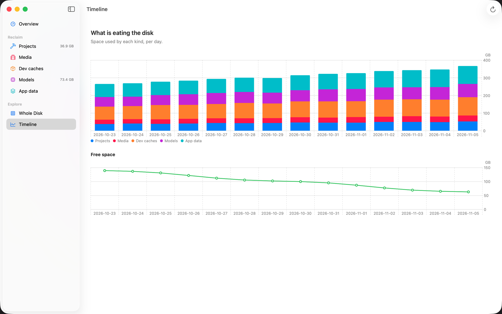

How much each category used, per day, as stacked bars, with free space as a
line underneath. A point is recorded every time recognition runs (at most one
per category per day), so the chart becomes useful after a few days of use.

## Menu bar

The menu bar shows free space. Click it for a small panel with free space, the
capacity bar, how much can still be freed, and **Open SuckMyDisk**. The menu
bar item keeps following the disk while the app runs, even with the window
closed. When a new version is waiting, the panel shows it with a button to
install it.

## Live updates and rescanning

After the first scan, SuckMyDisk watches the disk through FSEvents:

- A changed folder is re-read on its own, a new folder is scanned, a removed
  one drops out. A 2 GB download shows up within a few seconds.
- Folders that apps rewrite constantly (browser caches, logs) are re-read at
  most every few seconds. Huge ones (a Photos library, a cache with 100,000
  files) are marked stale and refreshed in the background every few minutes.
  Following the disk costs about 1% of one CPU core.
- Recognition (projects, frames, caches) reruns in the background when enough
  has changed.
- On launch, and every time `smd` runs, only the events since the index was
  last saved are replayed.

A full rescan happens on its own when the event history can't be trusted:
macOS dropped events, the volume's event database changed, or a new version of
SuckMyDisk changed the index format. You can also rescan any time with ⌘R.

## Updating SuckMyDisk

From version 0.5.0 on, SuckMyDisk keeps itself up to date from
[GitHub Releases](https://github.com/kadaliao/suck-my-disk/releases):

- About once a day it asks GitHub for the latest release. When that is newer,
  it downloads the app in the background (about 4 MB) and checks it: the
  download must match the release's `SHA256SUMS`, and the app inside must be
  SuckMyDisk at that version, signed with the same Developer ID as your copy
  and notarized by Apple. Anything else is thrown away.
- It installs the new version while SuckMyDisk is in the background with its
  window closed and nothing is scanning or cleaning: the app is replaced in
  one step, and it reopens in a second or two, still only in the menu bar.
  The index is saved first, so nothing is rescanned, and Full Disk Access
  carries over because the signature is the same.
- While you're using it, the bottom of the sidebar and the menu bar panel show
  the new version with **Relaunch to Update**; clicked during a scan or a
  cleanup, it relaunches once that ends. Quitting installs it too.

**Check for Updates…** in the SuckMyDisk menu checks right away and offers to
install. In **Settings** (⌘,) you can turn off automatic checks, or keep them
and turn off **Download and install automatically**: a new version is then
only offered, and installs when you click **Update**.

SuckMyDisk can't replace itself when it runs from the disk image or from a
quarantined location (move it into Applications first), or when your account
can't write to its folder. It then links to the download page instead. Builds
you make yourself don't update.

## Command line (`smd`)

`smd` uses the same engine, index and journal as the app. Output follows the
system language, not the app's Language setting; set `SMD_LANG=zh` or
`SMD_LANG=en` to force one.

### `smd things`

What uses space and what can go. Read-only.

```sh
smd things              # brings the index up to date, recognizes, prints the report
smd things -v           # every group and every item
smd things --json       # the full report as JSON
smd things --days 60    # projects count as asleep after 60 days instead of 30
smd things --rescan     # full disk scan first
smd things /Volumes/Backup   # an external disk: projects and render frames on it
```

Each reclaimable item gets a number:

```
━━ Projects  reclaimable 23.7 GB
  my-old-app  1.2 GB  · active 3mo ago（Claude Code）  ~/code/my-old-app
     asleep for 94 days
      1 [x] ● node_modules  845 MB
          npm dependencies, reinstallable from the lockfile  · restore: pnpm install
      2 [x] ● .next  312 MB
          front-end build cache  · restore: npm run build
```

`[x]` marks preselected items, `●` rebuildable ones (deleted, restore command
recorded) and `○` your own files (moved to the Trash). Long lists are cut
short; `-v` shows every item and its number.

### `smd reclaim`

Runs a plan. **It is a dry run unless you add `--yes`.**

```sh
smd reclaim                       # show the preselected plan
smd reclaim --add 12,14           # also include items 12 and 14
smd reclaim --remove 3            # leave item 3 out
smd reclaim --select 1,2,5        # exactly these items instead of the preselection
smd reclaim --add 12 --yes        # do it
smd reclaim --yes --force         # also act on items changed in the last 7 days
smd reclaim /Volumes/Backup --yes # the preselection on an external disk
```

Numbers refer to the last `smd things` report. `reclaim` reuses that report
for an hour, so run `smd things` again if it has been longer or if the disk
changed a lot. Items you name with `--select` or `--add` count as ticked by
hand, so rebuildable ones go even if they changed in the last 7 days.
`--force` lifts the 7-day rule for every item, your own files included; every
other safety rule still applies.

The output lists each item with what will happen (`delete`, `trash`, or the
command), then, with `--yes`, the space each one actually freed and the free
space before and after.

### `smd hibernate` and `smd wake`

Put a whole project to sleep: delete all its rebuildable artifacts, keep the
source and git.

```sh
smd hibernate ~/code/my-old-app          # dry run
smd hibernate ~/code/my-old-app --yes    # do it
smd wake ~/code/my-old-app               # print the commands that bring it back
```

The path must be a project root as shown by `smd things`. `wake` only prints
commands such as `cd ~/code/my-old-app && pnpm install`; it runs nothing.

### `smd apps` and `smd uninstall`

```sh
smd apps                         # every installed app, its size with data, caches, last opened
smd apps --json                  # the same as JSON
smd uninstall Zoom               # dry run: what goes to the Trash
smd uninstall Zoom --yes         # do it
smd uninstall Slack --keep-app   # dry run: only Slack's caches
smd uninstall /Applications/Slack.app --keep-app --yes
```

Name the app as `smd apps` shows it, by its file name, or by its path. The dry
run lists every data folder that would go and the warnings. Like
`smd hibernate`, the app counts as picked by hand, and every
[safety rule](#safety-rules) still applies: an app that is running is
skipped, naming the process. If an App Store app needs Finder and Finder can't
be reached (over SSH, say), the item fails with a note to drag the app to the
Trash yourself. Finder gets two minutes for its password dialog. `smd` always
goes through Finder: [the helper](#uninstalling-without-a-password) only
answers the app. Ctrl-C stops
the run the way the app's **Stop** does: the running step is ended, the item
is reported as stopped and the rest is not run; a second Ctrl-C quits at once.

### `smd journal`

The last 50 actions: time, result (`done`, `skipped`, `failed`, `stopped`), action, space
freed, and item. The app's cleanups are recorded here too.

### `smd top`

The biggest items under a folder, from the index (no rescan).

```sh
smd top                     # your home folder
smd top ~/Library -n 50
```

Tags explain special entries: `folded` (counted as a whole, such as
`node_modules`), `other volume`, `unreadable`, `sparse`, and `shared` (data
shared with other files through clones or hard links).

### `smd scan`

```sh
smd scan                    # full scan of the data volume; saves the index
smd scan ~/code ~/Movies    # one-off scan of these folders; prints totals, saves nothing
smd scan ~/code --threads 8
```

A full scan prints how much of the data volume it could see and how much is
hidden (snapshots, unreadable folders).

### `smd bench`

Scanner speed with 4, 8, 16 and 32 threads, for development. Defaults to
`~/workspace`.

### Environment variables

| Variable | Effect |
| --- | --- |
| `SMD_LANG` | `zh` or `en` forces the output language |
| `SMD_HOME` | Keep the index, report and journal in this folder instead of `~/Library/Application Support/SuckMyDisk` (the app keeps using the default) |

### Using `smd` from scripts and coding agents

`smd things --json` prints the whole report: every group with its kind
(`project`, `media`, `devCache`, `model`, `app`, `appData`, `system`), size, last
activity, and items with their tier, action, estimate, restore command,
warnings and whether they are preselected. Progress messages go to stderr, so
stdout is clean JSON.

A safe pattern for an agent: read `smd things --json`, show the person what it
plans to free, run `smd reclaim --select …` without `--yes` to get the dry
run, and only add `--yes` after they agree.

## Safety rules

These apply to the app and the CLI alike, and no recognizer can override them.

**Never deleted or trashed**

- your home folder itself, `~/Library` itself, `/`, `/Users`
- iCloud Drive (`~/Library/Mobile Documents`): deleting there deletes in the
  cloud
- cloud-storage folders (`~/Library/CloudStorage`: Dropbox, OneDrive, Google
  Drive, …)
- `~/Library/Mail`, `~/Library/Messages`, `~/Library/Keychains`, `~/.ssh`,
  `~/.gnupg`
- `/System`, `/usr`, `/bin`, `/sbin`, `/Library` and `/Applications/Utilities`
- folders that hold many apps: `/Applications` and `~/Applications` themselves,
  and `~/Library/Application Support`, `Caches`, `Containers`,
  `Group Containers`, `Preferences`, `Saved Application State`, `HTTPStorages`,
  `WebKit`, `Logs`, `Cookies` and `LaunchAgents` themselves
- anything System Integrity Protection guards
- anything inside a `.git` folder
- Photos, Music, TV, iMovie and Final Cut libraries

**Checked again right before each item runs**

- the path still exists and is not a symlink
- git tracks no file at or below it (if git can't answer, it is treated as
  tracked)
- no running program uses it: it is neither where a running program lives nor
  among its arguments (if the running programs can't be listed, nothing is
  deleted). A skipped item names the program and its PID.
- for an app's items, nothing runs from that app (its main program, helpers,
  or a copy macOS runs from elsewhere), and the app is still installed
- for browser records, the browser is not running, and no program holds the
  database: it must be possible to take an exclusive lock on it
- it has not changed in the last 7 days, unless it is a rebuildable item, an
  app's item or browser records you ticked yourself (the CLI's `--force` lifts this one for every item). A
  skipped item says when it can go: “changed Oct 31, 18:07; can be cleaned
  after Nov 7, 18:07”.
- for uv's cache commands, no uv is running. A long-running `uv run` holds the
  cache lock, and `uv cache prune` would wait 5 minutes for it and then fail;
  the item is skipped at once and names that process instead.

**How things are removed**

- Rebuildable items are deleted, and the restore command goes into the
  journal. Before a Python virtualenv is deleted, its `pyvenv.cfg` and a
  `pip freeze` are saved in the journal so it can be rebuilt faithfully.
- Your own files are moved to the Trash.
- Browser records are erased from the browser's own SQLite databases with
  DELETE statements in one transaction, then the database is compacted. Only
  ever when you tick them; never preselected.
- Uninstalling moves the app and its data to the Trash. An app that belongs to
  the system (App Store, installers) is moved by Finder, which asks for your
  password, or by [the helper](#uninstalling-without-a-password) if you turned
  it on. The helper moves nothing but an app in the Applications folder, and
  only into your own Trash.
- When a tool has its own cleanup command, that command runs instead.
- App data under App data is never deleted; you get instructions. Under Apps,
  an app's data goes only with the whole app, to the Trash, or as its caches.

## Data and privacy

Nothing about your disk leaves the Mac. There is no account and no telemetry.
The only network requests are the [update check](#updating-suckmydisk): about
once a day SuckMyDisk asks `api.github.com` for the latest release, and
downloads it from GitHub when it is new. The requests carry the app's version
and nothing else. Turn them off in Settings.

**What it stores**, in `~/Library/Application Support/SuckMyDisk/`:

| File | Contents |
| --- | --- |
| `index-<volume-uuid>.bin` | The disk index: names, sizes and dates of files and folders |
| `last-report.json` | The latest recognition report |
| `report-<volume-uuid>.json` | The latest report for an external disk (its index is an `index-<volume-uuid>.bin` too) |
| `smd.sqlite` | Daily size history (for the Timeline) and the journal of every cleanup |

A downloaded update waits in `~/Library/Caches/com.kadaliao.SuckMyDisk/Updates`
until it is installed. Settings are in the `com.kadaliao.SuckMyDisk`
preferences.

**What it reads**

- File and folder metadata (names, sizes, dates, clone and hard-link
  information) for the whole data volume, minus the
  [privacy-protected folders](#full-disk-access) when it lacks Full Disk
  Access, and for each connected external disk.
- To estimate when you last worked on a project: the folder names and dates in
  `~/.claude/projects`, the working directory recorded at the start of Codex
  session files (`~/.codex/sessions`), `cd` commands in fish and zsh history,
  and Spotlight's last-used date. Nothing from these is stored apart from the
  resulting date and its source name.
- A few small files to recognize things: `pyvenv.cfg`, Ollama manifests,
  Xcode's `info.plist` in DerivedData, the headers of frame images and
  candidate videos.
- For [Apps](#apps): each app's `Info.plist`, the date Finder records when an
  app is opened (and Spotlight's), the names of the files in
  `~/Library/Preferences`, `LaunchAgents`, `Cookies` and `HTTPStorages`, the
  names in `/Library/LaunchDaemons`, `/Library/LaunchAgents` and
  `/Library/PrivilegedHelperTools`, and Homebrew's install receipts in its
  `Caskroom`.
- For [Large files](#large-files): Spotlight's last-used date and download
  source of each listed file, whether it is in iCloud, and `git ls-files` for
  the ones inside a repository.
- For [Browsers](#browsers): each browser's profile list (`Local State`,
  `profiles.ini`), and the **number of rows** in its history, cookie and form
  tables (opened read-only, without locking). Nothing is read out of those
  rows, and nothing about them is stored except the counts in the report.
- Answers from tools it asks read-only questions: `uv cache dir`,
  `pnpm store path`, `xcrun simctl list devices`, `docker system df`,
  `tmutil listlocalsnapshots`, `git check-ignore` and `git ls-files`.

## Uninstalling

1. If you turned on [the helper](#uninstalling-without-a-password), turn it
   off in Settings. Then quit SuckMyDisk.
2. Delete `/Applications/SuckMyDisk.app`, and `smd` from wherever you put it.
3. Delete its data:

   ```sh
   rm -rf ~/Library/Application\ Support/SuckMyDisk ~/Library/Caches/com.kadaliao.SuckMyDisk
   defaults delete com.kadaliao.SuckMyDisk
   ```

4. Optionally remove SuckMyDisk from System Settings → Privacy & Security →
   Full Disk Access.

If you installed with Homebrew, `brew uninstall --cask --zap suck-my-disk`
and `brew uninstall smd` do steps 1–3 (the data goes to the Trash).

## FAQ and troubleshooting

**Why do the numbers differ from Finder or System Settings?**
SuckMyDisk uses decimal units like Finder (1 GB = 1,000,000,000 bytes), but
counts APFS clones and hard links once and reports the data volume, not the
whole APFS container. The overview's *Honest numbers* section accounts for
the rest: snapshots, unreadable folders, purgeable space, and the system
volumes.

**I cleaned up, but free space barely changed.**
Usually one of these:
- A local snapshot still holds the deleted data. It is released when macOS
  removes the snapshot (Time Machine and update snapshots expire on their
  own).
- Items went to the Trash; empty it.
- The data was shared with something you kept (clones, hard links). The
  warnings on the item say how much.
- Docker's virtual disk shrinks later, not immediately.

**Why isn't X preselected?**
Preselection is deliberately conservative. Look at the item's ⚠ warnings:
the project is active, there is no lockfile, it changed in the last 7 days,
its data is shared, or it belongs to a category where nothing is preselected
(models, image sequences, the whole uv cache, old simulators). You can still
tick it yourself.

**An item was skipped with "changed …; can be cleaned after …".**
That rule protects work in progress. It holds back your own files and items
you didn't tick yourself (preselected ones, in case they changed after the
scan). Tick a rebuildable item yourself to clean it anyway, or wait until the
date shown. From the CLI, `--force` lifts the rule.

**The uv cache was skipped because a uv process is running.**
A running `uv run` (a long-lived server, say) holds the uv cache lock, and
uv can't clean its cache until that process exits. Stop it, or clean up
another time.

**The npm cache keeps coming back.**
That's expected: npm refills `~/.npm/_cacache` whenever it downloads
something, and `npx` adds a folder under `~/.npm/_npx` for every new version
of a tool it runs. Both are listed under Dev caches. If cleaning the npm cache
fails with `env: node: No such file or directory`, update to 0.3.1 or newer.

**How do I get something back?**
Rebuildable items: run the restore command shown in the list, in the journal
(`smd journal`), or from `smd wake <project>`. Your files and uninstalled apps:
open the Trash and use **Put Back**.

**Uninstall was skipped: "… is running; quit it first".**
Something from inside the app is still running: the app, a menu bar helper, or
a background service it started. Quit the app (and its helper, if it has one
in the menu bar) and try again. The message names the process and its PID.

**Does uninstalling remove everything the app left?**
Everything SuckMyDisk could match to it in your Library, which is listed under
the item before you confirm. It doesn't touch components installed for every
user (`/Library`, privileged helpers; a warning says when there are some), or
folders whose names don't give the app away. Apps with their own uninstaller
remove those better.

**I uninstalled an app but free space didn't change.**
It's in the Trash. Empty the Trash to get the space back.

**macOS asked me whether SuckMyDisk may access a folder.**
It shouldn't: without Full Disk Access those folders are skipped. Please
[open an issue](https://github.com/kadaliao/suck-my-disk/issues) with the
folder's name and your macOS version.

**The badge says "Not following".**
The live watcher isn't running, so numbers may be out of date. Rescan with ⌘R.
If it keeps happening, please open an issue.

**Does it scan external drives?**
Yes, in 0.4.0 and newer: each connected disk gets its own page (see
[External disks](#external-disks)), and `smd things /Volumes/<name>` does the
same from the command line. Earlier versions scan only the startup disk.

**Can I change the 30-day "asleep" threshold?**
In the CLI, with `smd things --days N`. The app uses 30 days.

**Can I try SuckMyDisk without letting it scan my disk?**
Start it in demo mode. It shows made-up projects, caches and models, reads
nothing from your disk, writes nothing, and Clean Up only pretends. Quit any
running SuckMyDisk first, then:

```sh
open -n -a SuckMyDisk --args --demo
```

Demo mode needs SuckMyDisk 0.3.0 or later. The screenshots in this guide come
from it.

**Upgrading made the first launch slow.**
When a release changes the index format, the first launch does one full scan.
The release notes say when that happens.

## Known limitations

- External disks are not followed live: they are scanned when plugged in, on
  ↻ and after Clean Up. Only projects and render frames are recognized on
  them.
- The *lossless* tier (merging duplicate files into APFS clones) exists in
  the engine but no recognizer produces it yet.
- Recognizers cover a fixed list of tools. Missing one? See
  [CONTRIBUTING.md](../CONTRIBUTING.md#adding-a-recognizer) or open a
  recognizer request.
- Full Disk Access is requested through a banner only; there is no guided
  setup yet.
- Apps: data left behind by apps that are already gone is not listed, and
  components an app installed for every user are not removed.
- `smd` doesn't update itself. Download it again from Releases when the app
  updates.
