# SuckMyDisk 使用指南

[English](user-guide.md) · **简体中文**

这份指南介绍 App、`smd` 命令行、安全规则，以及 SuckMyDisk 会读什么、存什么。
安装方法见 [README](../README.zh-CN.md#安装)。

- [第一次运行](#第一次运行)
- [完全磁盘访问](#完全磁盘访问)
- [主窗口](#主窗口)
- [概览](#概览)
- [清理列表](#清理列表)
  - [项目](#项目) · [作品](#作品) · [开发缓存](#开发缓存) · [模型](#模型) · [大文件](#大文件) · [应用](#应用) · [应用数据](#应用数据)
  - [浏览器](#浏览器)
- [动手清理](#动手清理)
- [全盘](#全盘)
- [时间线](#时间线)
- [菜单栏](#菜单栏)
- [实时更新与重新扫描](#实时更新与重新扫描)
- [自动更新](#自动更新)
- [命令行 smd](#命令行-smd)
- [安全规则](#安全规则)
- [数据与隐私](#数据与隐私)
- [卸载](#卸载)
- [常见问题](#常见问题)
- [已知限制](#已知限制)

## 第一次运行

第一次打开 SuckMyDisk，它会扫描整块启动磁盘。大约五百万个文件的磁盘，
要半分钟到一分钟；窗口底部的小胶囊会显示已经扫了多少文件、多少字节。

扫描完，SuckMyDisk 会识别项目、渲染帧、缓存和模型，然后显示概览。
从这以后，索引会保存下来，并通过 FSEvents 保持最新。之后再打开，
只需要补上 App 关着时发生的改动（通常不到一秒）。

App 跟随系统语言：首选语言是中文就显示中文，否则显示英文。想自己选的话，
打开**设置**（⌘,）→「语言」，选简体中文或 English；重新打开 App 后生效
（点「立即重新打开」一两秒就好，扫描结果都会保留）。同一处的「外观」可以选浅色或深色，
不跟随系统，改了马上生效。

## 完全磁盘访问

有些文件夹，macOS 要先问过你才让 App 读：桌面、文稿、下载、iCloud 云盘、
其他 App 的容器，以及外接磁盘。SuckMyDisk 不会为每个文件夹弹一次窗，
而是在拿到「完全磁盘访问」之前先跳过它们，并在概览页用一条提示说明少算了什么。
有了完全磁盘访问，[外接磁盘](#外接磁盘)一插上就会扫描；没有的话，磁盘页面会等你点「扫描」，
macOS 会问一次。

开启方法：

1. 点提示里的「打开系统设置」，或者打开 系统设置 → 隐私与安全性 → 完全磁盘访问权限。
2. 打开 SuckMyDisk 的开关（列表里没有的话，点 **+** 从 `/Applications` 里添加）。
3. 退出 SuckMyDisk，再重新打开。

`smd` 的权限由运行它的终端 App 决定，所以要给终端（终端、iTerm2、Ghostty…）
开启完全磁盘访问。

SuckMyDisk 测量磁盘时只读文件的元数据。具体会打开哪些东西，见
[数据与隐私](#数据与隐私)。

## 主窗口

侧边栏分三组；接了外接磁盘时还有第四组：

| 分组 | 内容 |
| --- | --- |
| — | **概览** |
| 可以清理 | **项目**、**作品**、**开发缓存**、**模型**、**应用**、**应用数据**；每一项旁边显示能腾出多少（「应用」显示应用连同数据一共占多少） |
| 透视 | **全盘**（方块图）、**时间线**（每天的增长） |
| 外接磁盘 | 每块接着的磁盘一行，见[外接磁盘](#外接磁盘) |

工具栏的 ↻ 按钮（或菜单 **文件 → 重新扫描**，⌘R）会重新扫描当前看的那块盘：启动磁盘，
或者正打开着页面的外接磁盘。启动磁盘一般用不上，见[实时更新与重新扫描](#实时更新与重新扫描)。

## 概览

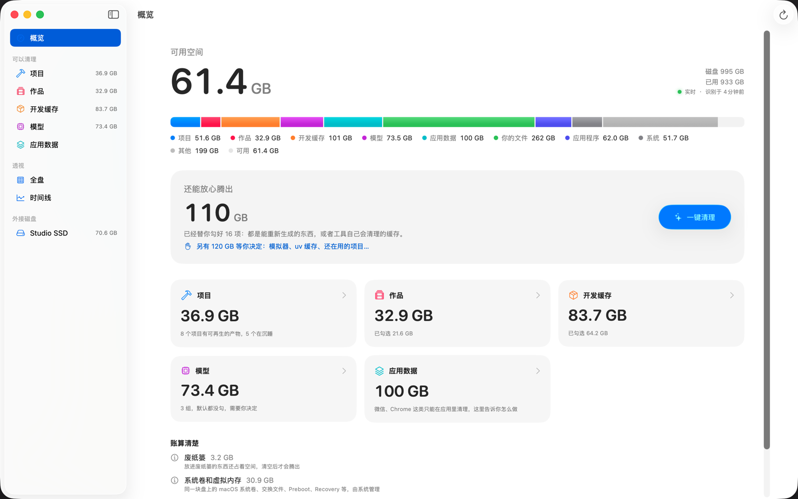

- **可用空间**，右边是磁盘总量和已用空间。下面的小标记显示索引的状态：
  「实时」、正在追上离开期间的改动，或者「未在跟踪」，以及上一次识别是什么时候。
- **容量条。** 已用空间按项目、作品、开发缓存、模型、应用数据、你的文件、
  应用程序、系统、其他分段，最后是可用。
- **还能放心腾出。** 预选项目的合计：只包括能重新生成的东西，
  或者工具自己会清理的缓存。**一键清理** 会打开确认窗口，里面正好是这些项目。
- **「另有 … 等你决定」。** 能腾出但没有预选的部分超过 1 GB 时
  （模拟器、整个 uv 缓存、还在用的项目），会出现这个链接，点了直接过去。应用不算在这里面。
- **分类卡片。** 每个清理列表一张，写着合计（「应用」写的是应用连同数据占的空间）；点开进入对应列表。
- **账算清楚。** SuckMyDisk 能解释、但没法替你腾出的空间：
  - **废纸篓**：清空之前还占着空间。
  - **本地快照**：由 macOS 更新和时间机器创建。快照占的空间扫描不到；
    有快照时，删掉的文件也不会马上释放。
  - **数据卷里扫描不到的部分**：数据卷已用空间减去扫描到的部分
    （快照占用、没有权限读的目录），以及 macOS 标记为可清除的空间。
  - **系统卷和虚拟内存**：只读的系统卷、交换文件、Preboot、Recovery。

## 清理列表

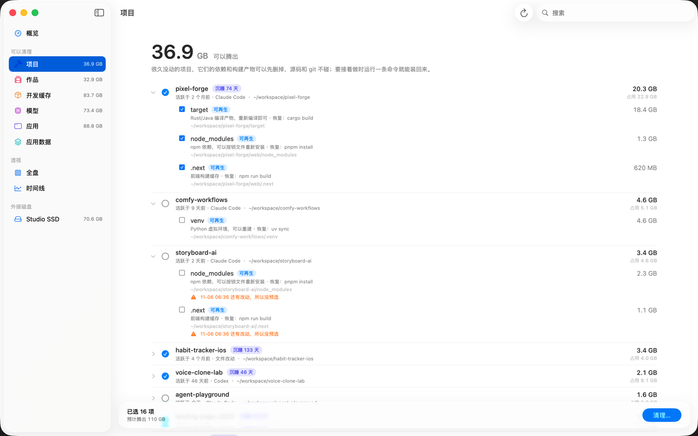

项目、作品、开发缓存、模型、应用、应用数据这几个列表长得一样：

- 顶部是能腾出的合计，加一句说明这个列表是什么。工具栏里的搜索框可以过滤列表。
- **分组**（一个项目、一份缓存、一个模型仓库）。点一行可以展开。
  圆圈用来全选或全不选这一组（显示横线表示选了一部分）。标题下面写着最后活跃时间、
  依据是什么（Claude Code、Codex、shell、文件改动、Finder），以及路径。
  右边是能腾出多少，灰色小字是它一共占用多少。
- **条目**：每个分组里的具体项目，各带一个勾选框、一个标签、列出它的理由和恢复命令：

  | 标签 | 含义 | 操作 |
  | --- | --- | --- |
  | 可再生 | 能重新构建或重新下载 | 直接删除，或运行工具的清理命令 |
  | 进废纸篓 | 你自己的文件 | 移到废纸篓 |
  | 指引 | 只有它所属的 App 能清理 | 不做任何操作，只给出说明 |

- 大小后面带 **+**（比如 `565 MB+`），表示有一部分数据通过 APFS 克隆或硬链接
  和别的文件共享，所以这只是下限。大的条目会在识别完成后换成精确数字。
- **⚠ 警告** 说明为什么没有预选：7 天内有改动、没有锁文件、和别的文件夹共享数据，等等。
- 在分组或条目上右键，可以选「在访达中显示」。
- 选中任何东西后，底部会出现一条栏，显示选了几项、能腾出多少，以及 **清理…** 按钮。

后台刷新不会清掉你的勾选。

### 项目

项目指 git 仓库，或者带包清单文件的文件夹（`package.json`、`pyproject.toml`、
`Cargo.toml`、`go.mod`、`Package.swift`、Xcode 工程、`pom.xml`、Gradle、`setup.py`、
`Gemfile`、`pubspec.yaml`、`CMakeLists.txt`）。个人文件夹里的隐藏文件夹和
`~/Library` 不会去找项目。

在每个项目里，SuckMyDisk 会找构建产物和依赖：

| 产物 | 识别条件 | 恢复命令 |
| --- | --- | --- |
| `node_modules` | 旁边有 `package.json` | 按锁文件用 `pnpm install`、`bun install`、`yarn install` 或 `npm ci`；没有锁文件就用 `npm install` |
| 虚拟环境（`.venv`，或任何带 `pyvenv.cfg` 的文件夹） | 在项目里 | `uv sync`、`poetry install`，或 `python3 -m venv`（加上 `pip install -r requirements.txt`） |
| `target` | Cargo 或 Maven 项目，或者里面有 `CACHEDIR.TAG` | `cargo build` / `mvn package` |
| `.next`、`.nuxt`、`.turbo`、`.svelte-kit`、`.parcel-cache`、`.angular` | 旁边有 `package.json` | `npm run build` |
| `.build` | 旁边有 `Package.swift` | `swift build` |
| `.gradle` | Gradle 项目 | `./gradlew build` |
| `.dart_tool` | 旁边有 `pubspec.yaml` | `flutter pub get` |
| `build`、`dist`、`out` | git 忽略了这个文件夹、里面没有 git 跟踪的文件、也没有视频或音频 | JS 项目用 `npm run build` |
| `__pycache__`、`.mypy_cache`、`.pytest_cache`、`.ruff_cache` | 项目里任何位置；合在一起显示为「Python 缓存」 | 运行时自动重建 |

30 天里没有任何活跃迹象的项目算作**沉睡**。活跃度按时间取最新的一条，来源有：
在这个文件夹里的 Claude Code 和 Codex 会话、fish 或 zsh 历史里的 `cd` 记录、
Spotlight 的上次使用时间，以及项目里文件的修改时间。

一个产物要同时满足三个条件才会**预选**：项目在沉睡；证据充分（比如有锁文件，
重装后版本不变）；里面的东西 7 天内没有改动。活跃的项目也会列出来，只是不勾，
你仍然可以手动腾出它们的空间。

源码和 `.git` 永远不碰。`smd wake` 会给出把项目依赖装回来的命令。

### 作品

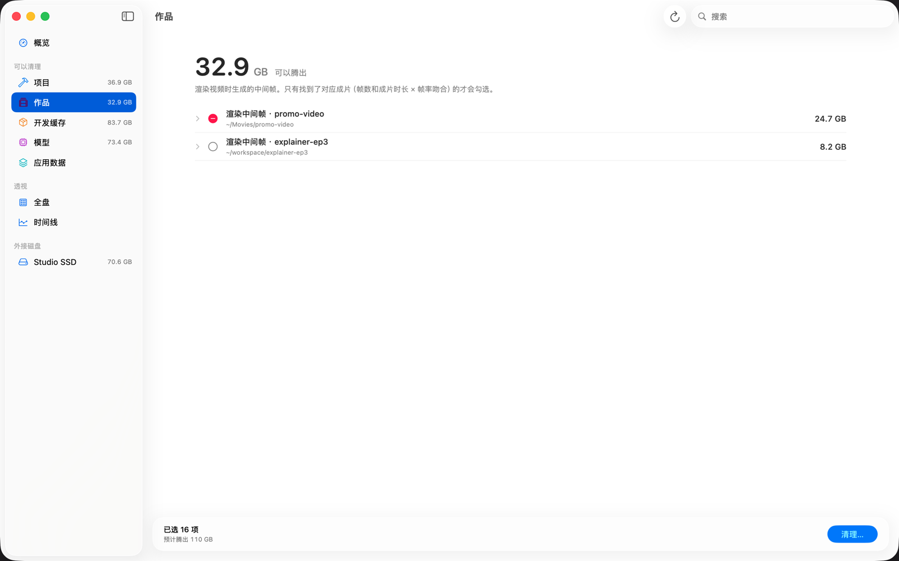

渲染出来的帧文件夹：至少 300 张图片（`png`、`jpg`、`exr`、`tif`、`dpx`…），
并且不小于 50 MB。帧按所属的项目分组。

- 如果附近有一个视频，帧数和这些帧一样（最多差几帧），这些帧就是**可再生**的：
  成片已经在了，帧也能从原工程重新渲染。除非是 7 天内刚渲染的，否则会预选。
  在别的项目里（有自己的 git 仓库或清单文件）的视频不算，挨着另一组帧的视频也不算：
  第 19 集的视频属于第 19 集的帧，哪怕第 20 集自己的视频已经没了。
- 找不到对应的视频时，这个文件夹会显示为**图片序列**，按你的文件处理（进废纸篓），
  也不预选。连拍照片、相册文件夹会落在这里。

只会提供帧文件夹本身，绝不会是它的上一级：渲染文件夹里常常还放着花钱买的
TTS 配音和静帧。

### 开发缓存

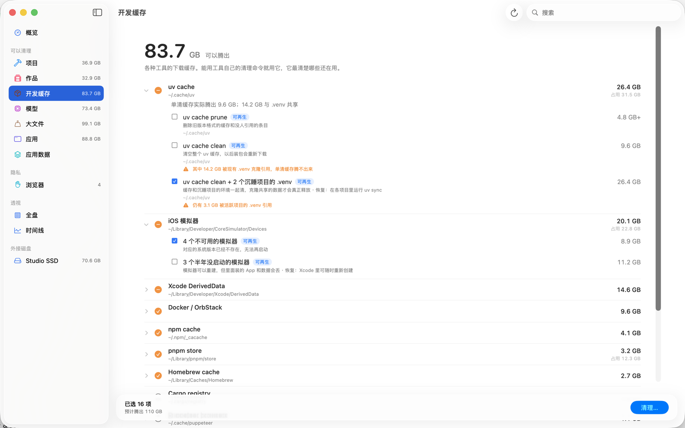

| 缓存 | 操作 | 预选 |
| --- | --- | --- |
| uv | `uv cache prune`（旧版本格式的缓存、没人引用的条目） | 是 |
| | `uv cache clean`（全部清空） | 否 |
| | `uv cache clean` 加上沉睡项目的 `.venv` | 比单独清任何一边多腾出很多时 |
| npm | `npm cache clean --force` | 是 |
| npx | 删除 npx 装在 `~/.npm/_npx` 里的包，每个包一行；正在运行的程序在用的（MCP 服务器常这样运行）和 7 天内装的不动 | 是 |
| pnpm store | `pnpm store prune`（没有项目在用的包） | 是 |
| bun | `bun pm cache rm` | 是 |
| Yarn | `yarn cache clean` | 是 |
| pip | 删除 `~/Library/Caches/pip` | 是 |
| Homebrew | `brew cleanup --prune=all -s` | 是 |
| Cargo registry | 删除 `~/.cargo/registry` | 否 |
| Puppeteer 浏览器 | 删除 `~/.cache/puppeteer` | 否 |
| Xcode DerivedData | 按项目逐个删除 | 对应工程已经不在，或 30 天没用过 |
| iOS 模拟器 | `xcrun simctl delete unavailable` | 是 |
| | 删除半年没启动过的模拟器 | 否（里面装的 App 和数据会丢） |
| Docker / OrbStack | `docker builder prune -f`、`docker image prune -f`（悬空镜像） | 是 |

工具没装的话，就直接删它的文件夹。小于 50 MB 的缓存不列出。

**为什么 uv 有三个选项。** uv 往每个 `.venv` 里装包时，用的是从缓存 APFS 克隆出来的文件。
克隆文件共享数据块，所以单清缓存，只能腾出没有 `.venv` 在用的那部分；单删 `.venv`，
也只能腾出缓存里没有的那部分。SuckMyDisk 把两边都量一遍，空间真正卡在两者共享的部分时，
就给出组合选项（缓存加上沉睡项目的环境）。警告里会写清还有多少仍在共享。

从不运行 `docker system prune`，因为它还会删掉停止的容器和你本地构建的镜像。
Docker 清理之后，Mac 上的虚拟机磁盘镜像可能要过一会儿才会缩小。

### 模型

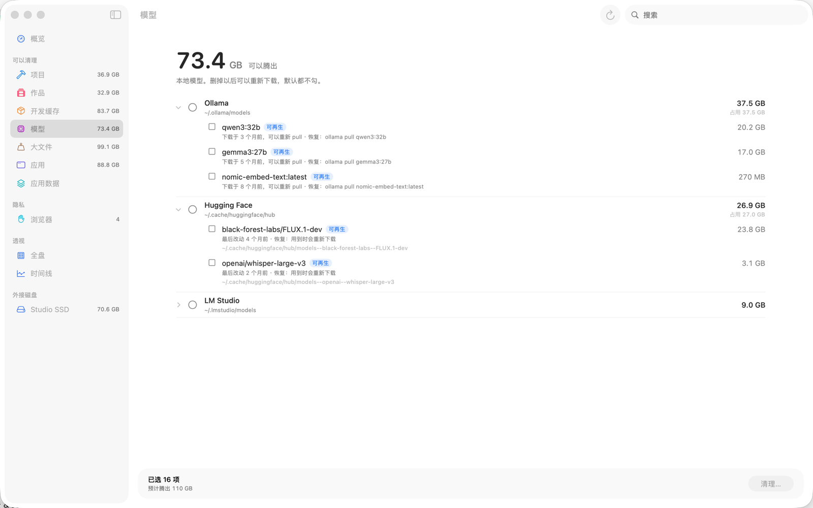

| 来源 | 操作 | 恢复 |
| --- | --- | --- |
| Ollama | `ollama rm <model>`（共享的层只算一次） | `ollama pull <model>` |
| Hugging Face | 装了 `hf` 命令行就用 `hf cache rm <repo>`，否则直接删除 | 用到时会重新下载 |
| ModelScope | 直接删除 | 用到时会重新下载 |
| LM Studio | 移到废纸篓 | 在 LM Studio 里重新下载 |

这里默认一个都不勾。

### 大文件

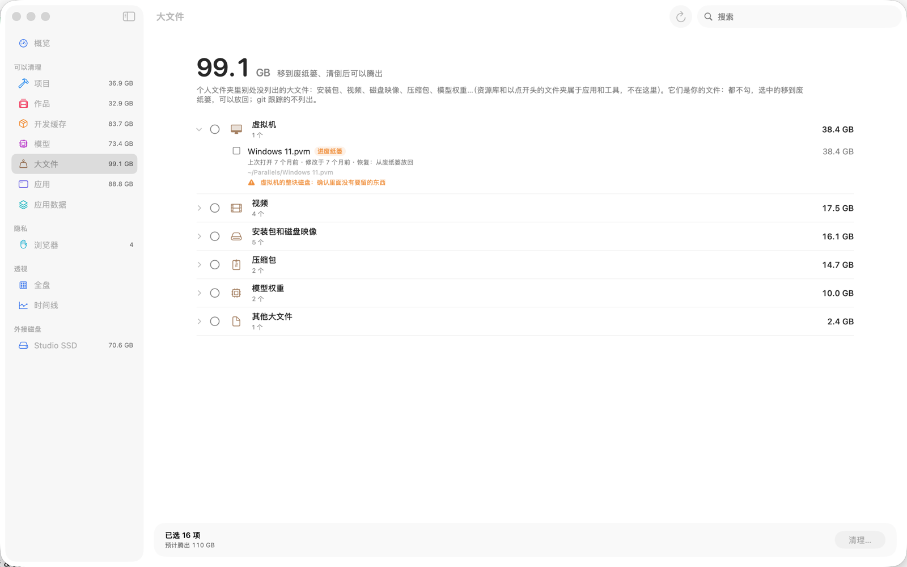

个人文件夹里别的列表都没解释的大文件，按种类分组，从大到小：

| 分组 | 例子 |
| --- | --- |
| 安装包和磁盘映像 | `.dmg`、`.pkg`、`.iso`、`.xip`、`.ipsw`、稀疏磁盘映像包（20 MB 起） |
| 虚拟机 | `.vmdk`、`.qcow2`、`.vdi`，Parallels、VMware、UTM 的虚拟机包 |
| 视频、音频 | `.mp4`、`.mov`、`.mkv`…，`.wav`、`.flac`… |
| 压缩包 | `.zip`、`.tar.gz`、`.7z`、`.rar`… |
| 模型权重 | `.safetensors`、`.gguf`、`.ckpt`、`.onnx`…。拆成好几片的模型（有 `model_index.json` 的文件夹，或权重旁边有 `config.json`）按整个文件夹列一项。 |
| 「应用程序」以外的应用 | 下载文件夹或构建目录里的 `.app` |
| 其他大文件 | 其余 100 MB 以上的文件；类型认不出来，先确认不是别的程序的数据 |

100 MB 起列出（安装包 20 MB 起），每组最多 50 个，组上会写还有多少没列出。
每个文件下面写着：安装包对应的应用是不是已经装了、上次打开是什么时候、从哪儿下载的（这两条来自 Spotlight），
以及最后修改的时间。

不列出：资源库和以点开头的文件夹（它们属于应用和工具）、别的列表已经列出的东西（项目的 `node_modules`、
渲染帧文件夹）、git 跟踪的文件、整体折叠的依赖文件夹、照片等媒体资料库，以及 Cryptomator 加密保险库的分块文件。

它们是你的文件：一个都不勾，选中的移到废纸篓，可以放回。和你的其他文件一样，勾上了也要等过 7 天规则。
在 iCloud 云盘里的文件（桌面和文稿开了 iCloud 同步）会带一条提醒：移到废纸篓会从你所有的设备上删掉。

### 应用

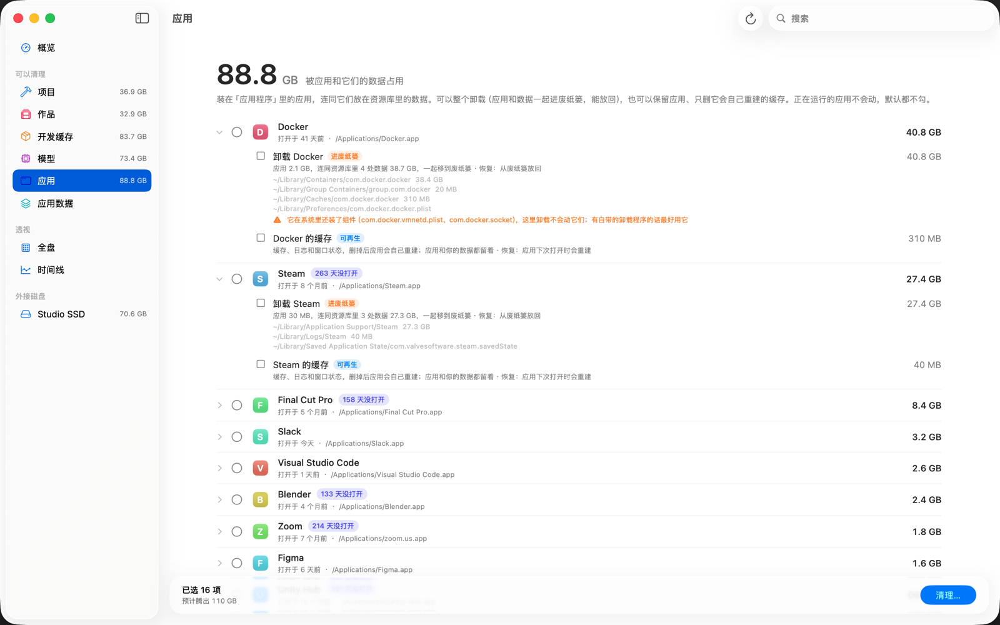

`/Applications` 和 `~/Applications` 里的每个应用（也看下一层，比如厂商自己的文件夹），
连同它放在资源库里的数据，按占用从大到小排。「实用工具」文件夹、受 macOS 保护的应用（Safari）、
符号链接和 SuckMyDisk 自己不列。应用名下面写着上次打开的时间（来自访达的记录和 Spotlight）
和位置；90 天没打开的会带一个「N 天没打开」的标签。

每个应用最多两个条目，默认都不勾：

| 条目 | 会怎样 | 标签 |
| --- | --- | --- |
| **卸载** | 应用和找到的所有数据文件夹一起移到废纸篓，应用先走。这些文件夹连同大小列在条目下面。 | 进废纸篓 |
| **缓存** | 删掉它的缓存、日志和窗口状态。应用、设置和你的数据都留着，下次打开时它会自己重建。合计 1 MB 以上才显示。 | 可再生 |

勾了「卸载」就包含了「缓存」。移到废纸篓的东西，清倒废纸篓后才腾出空间。

**怎么找到应用的数据**（都在 `~/Library` 里）：

| 文件夹 | 按什么认 | 卸载 | 缓存 |
| --- | --- | --- | --- |
| `Caches`、`Logs` | bundle id，或者和应用完全同名 | ✓ | ✓ |
| `Saved Application State` | bundle id | ✓ | ✓ |
| `Application Support` | bundle id，或者和应用完全同名 | ✓ | 里面的 `Cache`、`Code Cache`、`GPUCache` 等文件夹（Electron 和 Chromium 应用） |
| `Containers` | bundle id | ✓ | 里面的 `Data/Library/Caches` |
| `Group Containers` | `<团队 ID>.<bundle id>` 或 `group.<bundle id>` | ✓ | |
| `HTTPStorages`、`WebKit`、`Cookies` | bundle id | ✓ | |
| `Preferences`、`LaunchAgents` | bundle id（`.plist`） | ✓ | |

「bundle id」也包括在它后面接着的名字，比如 `com.tinyspeck.slackmacgap.ShipIt`，
或者扩展的 `….FinderSync`；两个应用的 id 都对得上时，归 id 更长的那个。和应用同名的文件夹，
只有这个名字专属于一个应用时才算（`Code`、`Google`、`Python` 这类不算，两个应用同名也不算）。
厂商自己的文件夹（比如 `com.microsoft`）不会被当成它某个应用的。`Containers` 和
`Group Containers` 要有[完全磁盘访问](#完全磁盘访问)才看得到。

「卸载」上的**警告**会说明：

- 访达会要管理员密码：App Store 或安装器装的应用归系统所有，SuckMyDisk 会请访达来移，
  就像你自己把它拖进废纸篓一样。第一次还会先问要不要允许 SuckMyDisk 控制访达。访达等你回应的时候，
  清理页上这一项下面会写明；两分钟没人回应，这一项算没清掉，应用留在原处。
  打开[卸载助手](#卸载时不用输密码)以后不会再弹密码框，这条警告也不再出现。
- 它给所有用户装了组件（`/Library` 里的启动守护进程、特权辅助程序）。这里卸载不会动它们；
  有自带的卸载程序的话最好用它。
- 它是 Homebrew 装的：卸载后再运行 `brew uninstall --cask <名字>`，Homebrew 才会忘掉它，
  命令行链接也会删掉。
- 它归 Setapp 管：在 Setapp 里卸载，不然 Setapp 可能会再装回来。

**安全。** 这个应用有任何东西在运行时（包括它的辅助程序，以及 macOS 从隐藏位置运行的副本），
两个条目都会跳过；先退出它。你亲手勾上的，不用等 7 天的规则（打开应用就会改动它的文件夹）：
对应用来说，要紧的检查是「没在运行」，而且东西不是进废纸篓就是能重建。扫描之后某个文件夹没了
（应用自己清了缓存），其余的照样处理；应用本身不在了，这一项就跳过。

#### 卸载时不用输密码

App Store 或安装器装的应用归系统所有，所以每次把它们移到废纸篓，访达都要一次管理员密码。想只确认一次的话，打开
**设置**（⌘,），打开 **卸载系统应用时不用输密码**。macOS 会打开 系统设置 → 通用 → 登录项与扩展，在那里允许
SuckMyDisk（只有这一次会要你的密码或触控 ID）。回到 SuckMyDisk，开关保持打开，以后这类应用就和别的应用一样直接进废纸篓。

你允许的是 SuckMyDisk 里面的一个小助手，由 macOS 以管理员权限运行。它被做得尽量小：

- 只做一件事：把直接放在「应用程序」文件夹里（或往下一层文件夹里）的应用移到你自己的废纸篓。「实用工具」、
  macOS 保护的东西、正在运行的应用、SuckMyDisk 自己，都不移。
- 只听这一份 SuckMyDisk 的（按签名核对），而且只为管理员账户办事，和访达的要求一样。
- 只在 SuckMyDisk 卸载东西的时候运行，半分钟没事就自己退出。
- 它移不动的时候，SuckMyDisk 照旧去请访达，清理记录里会写明原因。

用同一个开关或者在系统设置里都可以关掉。只有从 GitHub 下载的正式版带这个助手，`smd` 不用它。

### 应用数据

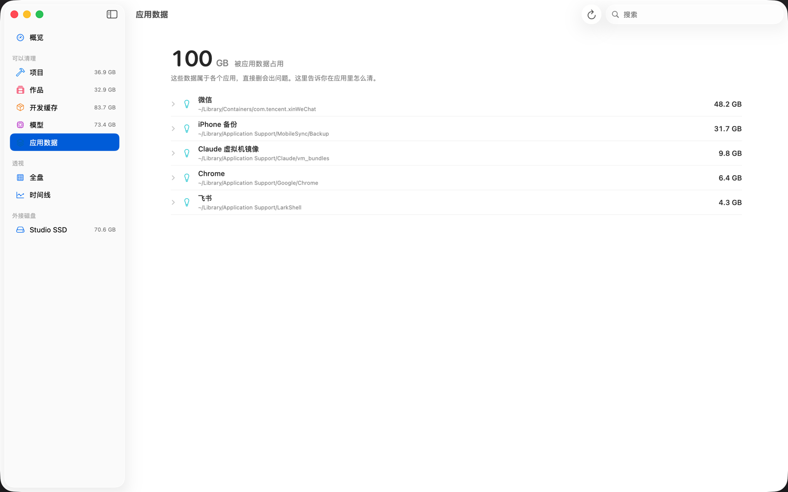

属于某个 App 的大块数据（1 GB 及以上）：微信、Chrome、飞书、Notion、
Claude 虚拟机镜像、OrbStack、iPhone 备份。直接删这些文件夹可能把 App 弄坏，
所以 SuckMyDisk 只告诉你在 App 里去哪儿清，比如「在微信里打开 设置 → 通用 →
存储空间 清理聊天文件」。想把应用连同所有数据一起删掉，请用[应用](#应用)。

### 浏览器

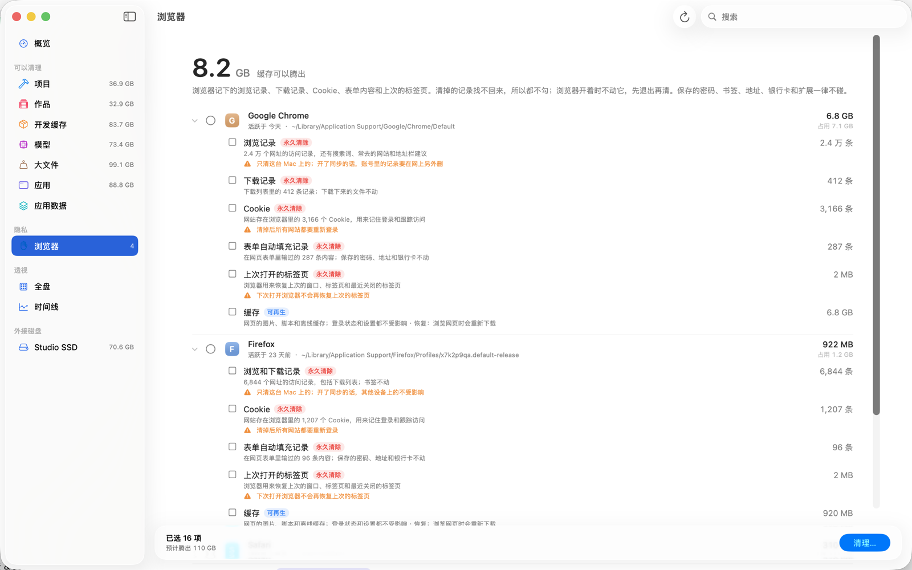

在侧边栏的 **隐私** 下面：每个浏览器记下的你去过哪儿。每个浏览器的每个用户资料一组，带应用图标。
应用删掉了、数据还留着的浏览器也会列出来，并标明。

| 条目 | 做什么 | 标签 |
| --- | --- | --- |
| **浏览记录** | 从浏览器的数据库里清掉访问记录、输入过的网址、搜索词、常去的网站、地址栏建议和输入预测。下载记录不动，除非也勾上。 | 永久清除 |
| **下载记录** | 清掉下载列表。下载下来的文件不动。 | 永久清除 |
| **Cookie** | 清掉所有 Cookie：所有网站都要重新登录。 | 永久清除 |
| **表单自动填充记录** | 在网页表单里输过的内容。保存的密码、地址和银行卡不动。 | 永久清除 |
| **上次打开的标签页** | 浏览器用来恢复上次的窗口和最近关闭的标签页的记录。 | 永久清除 |
| **缓存** | 网页的图片、脚本和离线缓存，浏览时会重新下载。登录状态和设置不受影响。 | 可再生 |

要清除的记录显示的是条数，不是大小：清掉记录几乎腾不出空间。

支持：Chrome（以及 Beta、Canary）、Chromium、Edge、Brave、Arc、Dia、Vivaldi、Opera、Comet、Yandex，
还有 Firefox、Zen、LibreWolf、Waterfox 和 Floorp。Firefox 的浏览记录包括下载列表，加了书签的网页会留下。

**Safari** 只给指引（缓存除外）：Safari 通过 iCloud 同步浏览记录，只有它自己的「历史记录」→「清除历史记录…」
能把其他设备上的也一起清掉。Cookie 和网站数据：「设置」→「隐私」→「管理网站数据…」→「全部移除」。
Safari 的记录条数要有完全磁盘访问才能读到。

**一律不碰：** 保存的密码、书签、地址和银行卡、搜索引擎、扩展和扩展的设置，以及 Local Storage 和 IndexedDB
（扩展也把设置存在那里）。

**安全。** 这里永远不预选。浏览器开着时它的条目都会跳过：先退出（有些浏览器关掉最后一个窗口后还在后台运行）。
数据库还被别的程序占着时原样不动。记录在一个事务里清除，数据库要么全部清掉、要么完全不变，清完再压缩，
不在空闲空间里留下残迹。只清这台 Mac 上的：开了浏览器同步的话，账号里的那份要在网上另外删。
亲手勾上的这些条目不用等 7 天规则（浏览器的数据这周总会改过）。

## 动手清理

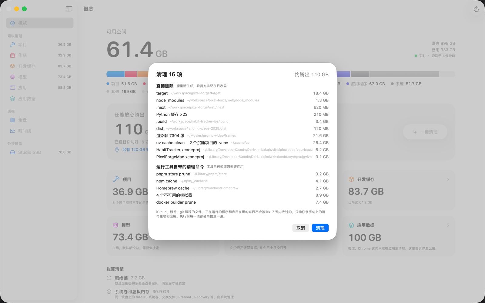

1. 点概览页的 **一键清理**（清理预选项目），或者列表底部栏的 **清理…**（清理你勾选的）。
2. 确认窗口会显示合计和每一项，按要做的事分组：
   - **永久清除浏览器记录**：清掉就找不回来；浏览器开着的会跳过。
   - **卸载应用**：应用和它的数据移到废纸篓。
   - **直接删除**：能重新生成，恢复方法记在日志里。
   - **运行工具自带的清理命令**：工具自己知道哪些还在用。
   - **移到废纸篓**：你的文件，可以从废纸篓找回。
3. 点 **清理** 确认，或者点 **取消**。

确认之后，整个窗口换成清理页面：

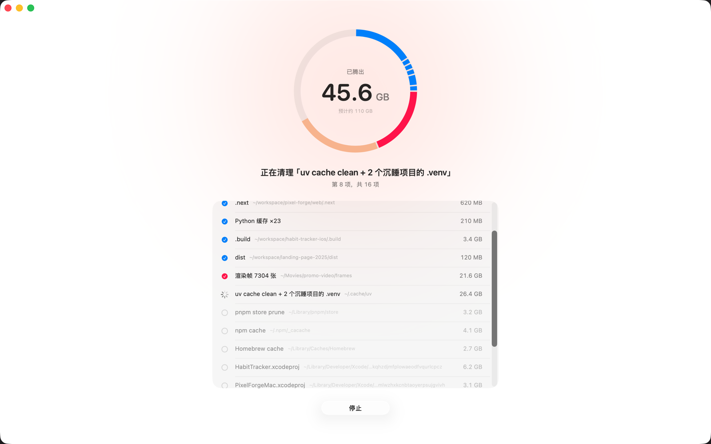

各项一个一个执行。圆环按每一项的类别颜色一段段点亮，中间的数字是到目前为止腾出的空间
（按磁盘可用空间的变化实测，不是估算）。下面的列表显示每一项是在等待、正在清理、已完成、跳过还是没清掉。
每一项动手前，所有[安全规则](#安全规则)都会再检查一遍；没通过的会跳过，并写明原因。
**停止** 随时能点：正在清理的这一项会在下一步之前停下（正在跑的清理命令、正在等的访达密码框都会被中断），
剩下的不动，已经清掉的不会回来。全部结束后，这一页就是结果：腾出了多少、
哪些没清掉以及原因、用了多久。点 **完成** 回到原来的页面。

移到废纸篓的东西，清空废纸篓之前仍然占着空间；结果里会写明有多少。

## 全盘

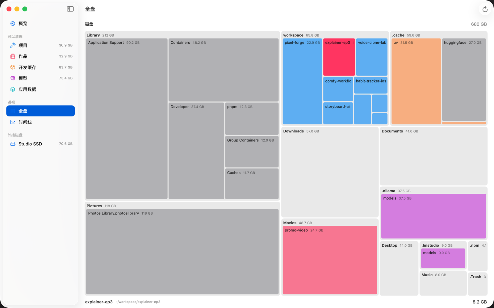

整块磁盘的方块图，颜色表示它属于哪一类。点一下方块钻进去，点地图上方路径里的名字可以返回。
清理之后，方块图会先提示你重新扫描，然后才显示。

## 外接磁盘

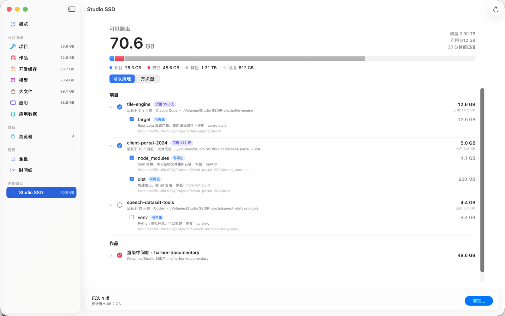

每块接着的磁盘（USB 或雷雳硬盘、SD 卡、可写的磁盘映像）都会在侧边栏「外接磁盘」下占一行。
它的页面显示这块盘上能腾出多少、一条容量条，以及两个视图：

- **可以清理**：这块盘上的项目和渲染帧，识别方法和启动磁盘一样。开发缓存、模型和应用数据都在你的
  个人文件夹里，所以仍在各自的分区。盘根目录下的隐藏文件夹（`.Trashes`、`.Spotlight-V100`，
  以及从个人文件夹搬过来的点文件夹，比如 `.vscode-server`）不参与识别。
- **方块图**：整块盘的方块图，和[全盘](#全盘)一样。

底部的 **清理…** 只处理这块盘，[安全规则](#安全规则)一条不少，结果显示的是这块盘实际腾出的空间。
没找到对应成片的图片序列会移到这块盘自己的废纸篓，清倒废纸篓之前腾不出空间。

外接磁盘不做实时跟踪。插上时（或者 SuckMyDisk 启动时它已经接着）、在它的页面点 ↻、
以及清理之后，会扫描一次。在那之前，页面显示上一次扫描的结果和扫描时间。

网络共享、只读的磁盘映像和时间机器备份盘不会列出来。

## 时间线

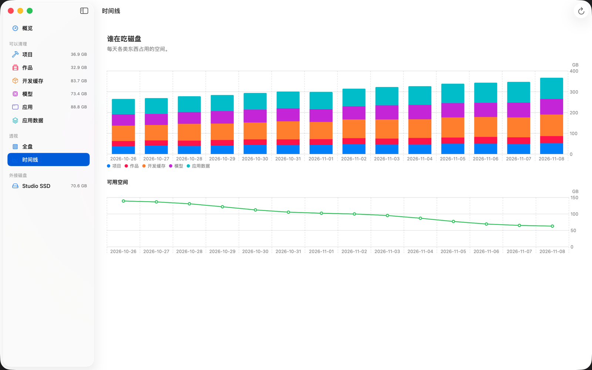

每天各类东西占了多少空间，用堆叠柱状图表示，下面用一条折线表示可用空间。
每次识别都会记一笔（每类每天最多一笔），用上几天之后，就能看出是谁在长。

## 菜单栏

菜单栏上显示可用空间。点它会弹出一个小面板：可用空间、容量条、「可以再腾出」多少，
以及「打开 SuckMyDisk」按钮。只要 App 在运行，哪怕关了窗口，菜单栏这一项也会一直跟着磁盘更新。
有新版本等着安装时，面板上会显示出来，附一个安装按钮。

## 实时更新与重新扫描

第一次扫描之后，SuckMyDisk 通过 FSEvents 盯着磁盘：

- 有改动的文件夹会单独重读，新文件夹会扫描，删掉的会从索引里去掉。
  下载一个 2 GB 的文件，几秒内就能看到。
- 被 App 不停改写的文件夹（浏览器缓存、日志）最多每隔几秒重读一次。
  特别大的（照片图库、有十万个文件的缓存）会先标记为过期，每隔几分钟在后台刷新。
  跟着磁盘更新大约只占一个 CPU 核心的 1%。
- 改动积累到一定程度，识别（项目、帧、缓存）会在后台重新跑。
- 每次启动 App、每次运行 `smd`，都只回放上次保存索引之后的事件。

事件历史不可信时，会自动做一次完整扫描：macOS 丢了事件、卷的事件数据库变了，
或者新版本的 SuckMyDisk 改了索引格式。你也可以随时按 ⌘R 重新扫描。

## 自动更新

从 0.5.0 起，SuckMyDisk 会从 [GitHub Releases](https://github.com/kadaliao/suck-my-disk/releases) 自己更新：

- 大约每天向 GitHub 查一次最新版本。比你的新，就在后台下载（大约 4 MB）并检查：
  下载的文件必须和发布页的 `SHA256SUMS` 对得上，里面的 App 必须是那个版本的 SuckMyDisk，
  签名和你手上这份出自同一个 Developer ID，并经过 Apple 公证。不符合的直接丢掉。
- 安装在 SuckMyDisk 处于后台、窗口关着、没有扫描或清理时进行：App 一步替换完，
  一两秒后自己重新打开，仍然只待在菜单栏。替换前先保存索引，所以不用重新扫描；
  签名没变，完全磁盘访问权限也照旧。
- 你正在用的时候，侧边栏底部和菜单栏面板会显示新版本和「重新打开并更新」按钮；
  扫描或清理进行中点它，会等那件事结束再重新打开。退出时也会装上。

SuckMyDisk 菜单里的「检查更新…」马上检查一次，有新版本就问你要不要装。
在**设置**（⌘,）里可以关掉自动检查；也可以保留检查、只关掉「自动下载并安装」，
这样新版本只会提示，点「更新」才装。

SuckMyDisk 从磁盘映像或被隔离的位置运行时（先把它拖进「应用程序」），
或者你的账户没有权限写它所在的文件夹时，没法替换自己，这时会改为给出下载页链接。
自己编译的版本不会自动更新。

## 命令行 smd

`smd` 和 App 用的是同一个引擎、同一份索引、同一份日志。输出跟随系统语言，
不受 App 设置里的「语言」影响；设置 `SMD_LANG=zh` 或 `SMD_LANG=en` 可以强制指定。

### `smd things`

看看空间被谁占了、能腾出多少。只读。

```sh
smd things              # 更新索引、识别，然后打印报告
smd things -v           # 列出每一组、每一项
smd things --json       # 以 JSON 输出完整报告
smd things --days 60    # 60 天没动才算沉睡，而不是 30 天
smd things --rescan     # 先完整扫描一遍磁盘
smd things /Volumes/Backup   # 外接磁盘：这块盘上的项目和渲染帧
```

每个能清理的条目都有一个编号：

```
━━ 项目  可腾出 23.7 GB
  my-old-app  1.2 GB  · 活跃于 3 个月前（Claude Code）  ~/code/my-old-app
     沉睡 94 天
      1 [x] ● node_modules  845 MB
          npm 依赖，可以按锁文件重新安装  · 恢复：pnpm install
      2 [x] ● .next  312 MB
          前端构建缓存  · 恢复：npm run build
```

`[x]` 表示预选，`●` 表示可再生（直接删除，并记下恢复命令），`○` 表示你自己的文件
（移到废纸篓）。列表太长会截断；加 `-v` 可以看到所有条目和它们的编号。

### `smd reclaim`

执行一个清理计划。**不加 `--yes` 就只是预演。**

```sh
smd reclaim                       # 显示预选的计划
smd reclaim --add 12,14           # 再加上第 12 和 14 项
smd reclaim --remove 3            # 去掉第 3 项
smd reclaim --select 1,2,5        # 只要这几项，不用预选
smd reclaim --add 12 --yes        # 真正执行
smd reclaim --yes --force         # 7 天内改过的条目也处理
smd reclaim /Volumes/Backup --yes # 清理外接磁盘上的预选项
```

编号对应上一次 `smd things` 的报告。`reclaim` 会沿用这份报告一个小时；
超过一小时，或者磁盘变化很大，就再跑一次 `smd things`。用 `--select` 或 `--add` 点名的条目
算你亲手勾选，其中可再生的 7 天内改过也照删。`--force` 对所有条目解除 7 天这一条规则，
包括你自己的文件；其他安全规则照样生效。

输出会逐项列出要做什么（「删除」「废纸篓」或者具体命令）；加了 `--yes` 之后，
还会显示每一项实际腾出了多少，以及执行前后的可用空间。

### `smd hibernate` 和 `smd wake`

让整个项目进入休眠：删掉它所有可再生的产物，源码和 git 不动。

```sh
smd hibernate ~/code/my-old-app          # 预演
smd hibernate ~/code/my-old-app --yes    # 真正执行
smd wake ~/code/my-old-app               # 打印把它恢复回来的命令
```

路径必须是 `smd things` 里显示的项目根目录。`wake` 只打印
`cd ~/code/my-old-app && pnpm install` 这样的命令，什么都不执行。

### `smd apps` 和 `smd uninstall`

```sh
smd apps                         # 所有装着的应用：连同数据的大小、缓存、上次打开
smd apps --json                  # 同样的内容，JSON 格式
smd uninstall Zoom               # 预演：哪些会进废纸篓
smd uninstall Zoom --yes         # 真正执行
smd uninstall Slack --keep-app   # 预演：只清 Slack 的缓存
smd uninstall /Applications/Slack.app --keep-app --yes
```

应用可以用 `smd apps` 里显示的名字、文件名或路径来指定。预演会列出要移走的每个数据文件夹和警告。
和 `smd hibernate` 一样，这算你亲手挑的，所有[安全规则](#安全规则)照样生效：应用在运行就跳过，
并写明是哪个进程。App Store 的应用要靠访达来移，访达连不上时（比如通过 SSH），
这一项会失败，提示你自己在访达里把它拖进废纸篓。访达的密码框最多等两分钟。`smd` 一律走访达：[卸载助手](#卸载时不用输密码)只听 App 的。按 Ctrl-C 和 App 里的
**停止** 一样：正在做的这一步被中断，这一项记为已停止，剩下的不运行；再按一次立刻退出。

### `smd journal`

最近 50 条操作：时间、结果（`done`、`skipped`、`failed`、`stopped`）、操作、腾出的空间、条目。
App 里的清理也会记在这里。

### `smd top`

某个文件夹下最大的东西，直接用索引（不重新扫描）。

```sh
smd top                     # 你的个人文件夹
smd top ~/Library -n 50
```

特殊条目会带标签：「整体」（整体计算，比如 `node_modules`）、「其他卷」、「无权限」、
「稀疏」，以及「共享」（通过克隆或硬链接和别的文件共享的数据）。

### `smd scan`

```sh
smd scan                    # 完整扫描数据卷，并保存索引
smd scan ~/code ~/Movies    # 只扫这几个文件夹，打印合计，什么都不保存
smd scan ~/code --threads 8
```

完整扫描会打印它在数据卷里看到了多少、有多少看不到（快照、没有权限读的目录）。

### `smd bench`

分别用 4、8、16、32 个线程测扫描速度，开发时用。默认测 `~/workspace`。

### 环境变量

| 变量 | 作用 |
| --- | --- |
| `SMD_LANG` | `zh` 或 `en`，强制指定输出语言 |
| `SMD_HOME` | 把索引、报告和日志放在这个文件夹，而不是 `~/Library/Application Support/SuckMyDisk`（App 仍然用默认位置） |

### 在脚本和编程 Agent 里用 smd

`smd things --json` 会输出完整报告：每一组的类别（`project`、`media`、`devCache`、
`model`、`app`、`appData`、`system`）、大小、最后活跃时间，以及每个条目的级别、操作、
预计腾出、恢复命令、警告和是否预选。进度信息走 stderr，所以 stdout 是干净的 JSON。

给 Agent 的稳妥用法：先读 `smd things --json`，把打算腾出的东西给人看；
用不带 `--yes` 的 `smd reclaim --select …` 拿到预演结果；等对方同意了，再加 `--yes`。

## 安全规则

App 和命令行都遵守这些规则，任何识别器都不能绕过。

**永远不会删除或移到废纸篓**

- 个人文件夹本身、`~/Library` 本身、`/`、`/Users`
- iCloud 云盘（`~/Library/Mobile Documents`）：在这里删，云端也跟着删
- 云存储文件夹（`~/Library/CloudStorage`：Dropbox、OneDrive、Google Drive…）
- `~/Library/Mail`、`~/Library/Messages`、`~/Library/Keychains`、`~/.ssh`、`~/.gnupg`
- `/System`、`/usr`、`/bin`、`/sbin`、`/Library` 和 `/Applications/Utilities`
- 装着很多应用的文件夹本身：`/Applications`、`~/Applications`，以及 `~/Library` 下的
  `Application Support`、`Caches`、`Containers`、`Group Containers`、`Preferences`、
  `Saved Application State`、`HTTPStorages`、`WebKit`、`Logs`、`Cookies`、`LaunchAgents`
- 受系统完整性保护（SIP）的东西
- `.git` 文件夹里的任何东西
- 照片、音乐、TV、iMovie 和 Final Cut 的资料库

**每一项动手前都会再检查**

- 路径还在，而且不是符号链接
- 它本身和它下面没有 git 跟踪的文件（git 答不上来时，按「有跟踪」处理）
- 没有正在运行的程序在用它：既不是程序本身所在的位置，也不在程序的参数里（列不出正在运行的程序时，一律不删）。跳过时会写明是哪个程序、PID 是多少。
- 应用的条目：这个应用没有任何东西在运行（主程序、辅助程序，或者 macOS 从别处运行的副本），而且应用还装着
- 浏览器记录：浏览器没在运行，也没有程序占着数据库（要能拿到它的独占锁）
- 7 天内没有改动，除非是你亲手勾上的可再生项、应用的条目或浏览器记录（命令行的 `--force` 对所有条目解除这一条）。跳过时会写明哪天能清，比如「10-31 18:07 改过，11-07 18:07 之后才能清」。
- 清 uv 缓存时，没有 uv 在运行。常驻的 `uv run` 占着缓存的锁，`uv cache prune` 会干等它 5 分钟然后失败；现在会马上跳过，并写明是哪个进程。

**怎么删**

- 可再生的直接删除，恢复命令记进日志。删除 Python 虚拟环境之前，会把它的
  `pyvenv.cfg` 和一份 `pip freeze` 存进日志，方便原样重建。
- 你自己的文件移到废纸篓。
- 浏览器记录用 DELETE 语句在一个事务里从浏览器自己的 SQLite 数据库里清掉，再压缩数据库。
  只在你亲手勾上时才做，永不预选。
- 卸载应用时，应用和它的数据移到废纸篓。归系统所有的应用（App Store、安装器装的）由访达来移，访达会要你的密码；打开了[卸载助手](#卸载时不用输密码)的话由助手来移。助手只移「应用程序」文件夹里的应用，而且只移进你自己的废纸篓。
- 工具有自带的清理命令时，运行那条命令。
- 「应用数据」里的东西从不删除，只给说明。「应用」里，应用的数据只会跟着整个应用进废纸篓，或者作为它的缓存被删掉。

## 数据与隐私

磁盘上的任何信息都不会离开这台 Mac。没有账号，不收集使用数据。
唯一的网络请求是[检查更新](#自动更新)：SuckMyDisk 大约每天向 `api.github.com` 查一次最新版本，
有新版本时从 GitHub 下载。请求里只有 App 的版本号。可以在设置里关掉。

**存了什么**，都在 `~/Library/Application Support/SuckMyDisk/` 里：

| 文件 | 内容 |
| --- | --- |
| `index-<volume-uuid>.bin` | 磁盘索引：文件和文件夹的名字、大小、日期 |
| `last-report.json` | 最近一次识别的报告 |
| `report-<volume-uuid>.json` | 外接磁盘最近一次的报告（它的索引同样是 `index-<volume-uuid>.bin`） |
| `smd.sqlite` | 每天的空间历史（给时间线用），以及每次清理的日志 |

下载好的更新在安装之前放在 `~/Library/Caches/com.kadaliao.SuckMyDisk/Updates`。
设置存在 `com.kadaliao.SuckMyDisk` 的偏好设置里。

**读了什么**

- 整个数据卷里文件和文件夹的元数据（名字、大小、日期、克隆和硬链接信息）。
  没有完全磁盘访问时，[受隐私保护的文件夹](#完全磁盘访问)除外。每块接着的外接磁盘也一样。
- 为了估计你上次什么时候碰过某个项目：`~/.claude/projects` 里的文件夹名和日期、
  Codex 会话文件（`~/.codex/sessions`）开头记录的工作目录、fish 和 zsh 历史里的
  `cd` 命令，以及 Spotlight 的上次使用时间。这些内容除了算出来的日期和来源名，
  什么都不保存。
- 识别时需要的几个小文件：`pyvenv.cfg`、Ollama 的 manifest、DerivedData 里
  Xcode 的 `info.plist`，以及帧图片和候选视频的文件头。
- 为了[应用](#应用)：每个应用的 `Info.plist`、访达在打开应用时记下的日期（以及 Spotlight 的）、
  `~/Library/Preferences`、`LaunchAgents`、`Cookies` 和 `HTTPStorages` 里的文件名、
  `/Library/LaunchDaemons`、`/Library/LaunchAgents` 和 `/Library/PrivilegedHelperTools` 里的名字，
  以及 Homebrew 在 `Caskroom` 里的安装记录。
- 为了[大文件](#大文件)：每个列出的文件在 Spotlight 里的上次打开时间和下载来源、它是不是在 iCloud 里，
  以及仓库里的文件用 `git ls-files` 查是否被跟踪。
- 为了[浏览器](#浏览器)：每个浏览器的用户资料列表（`Local State`、`profiles.ini`），以及浏览记录、Cookie
  和表单表里的**行数**（只读打开，不加锁）。不读这些行里的内容，除了报告里的条数，什么都不保存。
- 向一些工具问的只读问题：`uv cache dir`、`pnpm store path`、
  `xcrun simctl list devices`、`docker system df`、`tmutil listlocalsnapshots`、
  `git check-ignore` 和 `git ls-files`。

## 卸载

1. 如果打开过[卸载助手](#卸载时不用输密码)，先在设置里把它关掉。然后退出 SuckMyDisk。
2. 删除 `/Applications/SuckMyDisk.app`，以及你放 `smd` 的那个文件。
3. 删除它的数据：

   ```sh
   rm -rf ~/Library/Application\ Support/SuckMyDisk ~/Library/Caches/com.kadaliao.SuckMyDisk
   defaults delete com.kadaliao.SuckMyDisk
   ```

4. 也可以在 系统设置 → 隐私与安全性 → 完全磁盘访问权限 里把 SuckMyDisk 移除。

如果是用 Homebrew 装的，`brew uninstall --cask --zap suck-my-disk` 和 `brew uninstall smd` 就完成了第 1–3 步（数据会移到废纸篓）。

## 常见问题

**为什么数字和访达、系统设置里的不一样？**
SuckMyDisk 和访达一样用十进制单位（1 GB = 1,000,000,000 字节），但 APFS 克隆和硬链接
只算一次，而且统计的是数据卷，不是整个 APFS 容器。概览页的「账算清楚」解释了剩下的部分：
快照、没有权限读的目录、可清除空间和系统卷。

**清理完了，可用空间几乎没变。**
通常是下面几种情况之一：
- 本地快照还占着删掉的数据。macOS 删除快照后才会释放（时间机器和系统更新的快照会自己过期）。
- 东西进了废纸篓；清空它。
- 数据和你留下的东西共享（克隆、硬链接）。条目上的警告会写明有多少。
- Docker 的虚拟磁盘要过一会儿才缩小，不是立刻。

**为什么 X 没有预选？**
预选故意定得很保守。看看条目上的 ⚠ 警告：项目还在活跃、没有锁文件、7 天内有改动、
数据和别处共享，或者它所在的类别本来就一个都不预选（模型、图片序列、整个 uv 缓存、
旧模拟器）。你仍然可以自己勾上。

**有一项被跳过了，原因是「……改过，……之后才能清」。**
这条规则是为了保护正在进行的工作。它挡住的是你自己的文件，和不是你亲手勾的条目（预选的条目，以防扫描之后又改过）。可再生的条目你亲手勾上就能清；也可以等到写的那个时间。命令行里可以加 `--force`。

**uv 缓存被跳过了，说有 uv 进程在运行。**
正在运行的 `uv run`（比如一个常驻的服务）占着 uv 缓存的锁，它不退出，uv 就清不了缓存。先停掉它，或者换个时间再清。

**npm 缓存清了又回来。**
这是正常的：npm 每次下载东西都会往 `~/.npm/_cacache` 里放，`npx` 每运行一个工具的新版本，
就在 `~/.npm/_npx` 下多一个文件夹。两者都列在「开发缓存」里。如果清理 npm 缓存时报
`env: node: No such file or directory`，请升级到 0.3.1 或更新的版本。

**怎么把东西找回来？**
可再生的条目：运行列表里、日志里（`smd journal`）或 `smd wake <project>` 给出的恢复命令。
你自己的文件和卸载的应用：打开废纸篓，用「放回原处」。

**卸载被跳过了，说「……正在运行，先退出它」。**
应用里还有东西在运行：应用本身、菜单栏里的小助手，或者它启动的后台服务。退出应用
（菜单栏里有它的助手的话也退出），再试一次。提示里会写明进程名和 PID。

**卸载会把应用留下的东西都删干净吗？**
SuckMyDisk 能在资源库里认出来的都会删，确认前就列在条目下面。给所有用户装的组件
（`/Library` 里的、特权辅助程序；有的话会有警告）和名字看不出属于它的文件夹不会动。
有自带卸载程序的应用，用它删得更干净。

**卸载了应用，可用空间没变。**
它在废纸篓里。清倒废纸篓，空间才会回来。

**macOS 问我是否允许 SuckMyDisk 访问某个文件夹。**
这不应该发生：没有完全磁盘访问时，这些文件夹会被跳过。请
[提一个 issue](https://github.com/kadaliao/suck-my-disk/issues)，写上文件夹名和
macOS 版本。

**状态标记显示「未在跟踪」。**
实时监听没在运行，数字可能已经过时。按 ⌘R 重新扫描。如果反复出现，请提一个 issue。

**会扫描外接磁盘吗？**
会，0.4.0 及更新的版本：每块接着的磁盘有自己的页面（见[外接磁盘](#外接磁盘)），
命令行里用 `smd things /Volumes/<name>`。更早的版本只扫描启动磁盘。

**30 天算沉睡的门槛能改吗？**
命令行里可以，用 `smd things --days N`。App 固定用 30 天。

**能不让它扫描磁盘，先试试看吗？**
用演示模式启动。它展示的是虚构的项目、缓存和模型，不读也不写你的磁盘，「清理」也只是做做样子。
先退出正在运行的 SuckMyDisk，然后：

```sh
open -n -a SuckMyDisk --args --demo
```

演示模式需要 SuckMyDisk 0.3.0 或更新版本。本指南里的截图都来自演示模式。

**升级之后第一次打开很慢。**
如果某个版本改了索引格式，升级后第一次打开会做一次完整扫描。发布说明里会写明。

## 已知限制

- 外接磁盘不做实时跟踪：插上时、点 ↻ 时和清理之后各扫描一次，而且只识别项目和渲染帧。
- 引擎里有「无损」这一级（把重复文件合并成 APFS 克隆），但还没有识别器用到它。
- 识别器只覆盖一份固定的工具清单。缺了你在用的？见
  [贡献指南](../CONTRIBUTING.zh-CN.md#添加识别器)，或者提一个识别器需求。
- 完全磁盘访问目前只用一条提示来引导，还没有分步设置向导。
- 应用：已经删掉的应用留下的数据不会列出来；应用给所有用户装的组件不会删。
- `smd` 不会自己更新。App 更新后，到发布页重新下载一份。
